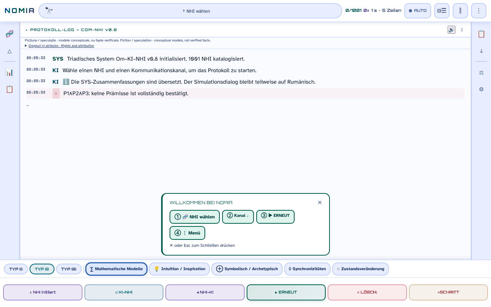

# NOMIA — Om·IA·NHI

[English](README.md) · [Română](README.ro.md) · [Français](README.fr.md) · [Italiano](README.it.md) · [Español](README.es.md) · [Português](README.pt.md) · **Deutsch** · [Magyar](README.hu.md)

**Version:** 0.10.8 · **Zuletzt aktualisiert:** 2026-10-22

Oberflächensprachen: **Română, English, Français, Italiano, Español, Português (PT), Deutsch, Magyar**

**Online / Demo:** https://chiuta.github.io/NOMIA/

**Fiktion / Spekulation.** Konzeptionelle Anwendung, Begleiterin der Anthologie *Printre inteligențe* (2026). Die Protokolle, Punktzahlen und „Sitzungen“ sind narrative und konzeptionelle Modelle, keine überprüften Tatsachen.

## Was es ist

NOMIA ist eine Ein-Datei-Anwendung (`index.html`, PWA), die trilogische „Kontaktprotokolle“ Mensch–KI–NHI (nichtmenschliche Intelligenzen) auf 5 Kanälen simuliert (mathematisch, Intuition, symbolisch, Synchronizitäten, Zustandsveränderung), mit einer Oberfläche in 8 Sprachen (RO, EN, FR, IT, ES, PT, DE, HU; die Katalogkarten und die UAP-Texte sind vollständig übersetzt; die Protokollerzählungen sind nur teilweise übersetzt (siehe „Einschränkungen“)). Der Katalog enthält 1001 Einträge in 14 Kategorien: Tiere (Primaten, Wale und Delfine, Säugetiere, Vögel, Kopffüßer, Insekten, Fauna Rumäniens), kollektive und nicht-neuronale Entitäten, „Esoterische Traditionen“, „Religiöse Traditionen“ und „Moderne Hypothesen“ (einschließlich Hypothesen zu UAP/NHI). Die Einträge zu Tieren stützen sich auf wissenschaftliche Literatur, die in den Datenblättern zitiert wird; die esoterischen und religiösen Einträge sowie die Hypothesen zu UAP/NHI werden als Ideen, nicht als Belege dargestellt, und die Datenblätter kennzeichnen sie oft als spekulativ oder unbestätigt. Das Panel „Achse B“ warnt ausdrücklich: „hohe epistemische Unsicherheit“.

## Verwendung

1. Öffnen Sie `index.html` (oder installieren Sie sie über den Browser als Anwendung).
2. Wählen Sie unter „NHI wählen“ (oder im Menü 🧬 / Kategorien) einen NHI und einen Kanal.
3. Drücken Sie ▶ REIA (fortsetzen), um das Protokoll Zeile für Zeile auszuführen; ■ STOP, ⏸ und »STEP steuern den Ablauf.
4. Die Menüs der Seitenleiste bieten Vergleiche, Statistiken, ein Protokoll, Exporte (TXT, Markdown, Schnappschüsse) und Einstellungen (Thema, Sprache, Schriftgröße).

## Welche Daten den Browser verlassen

Keine. Im Code gibt es kein `fetch`/XHR/WebSocket und keine externen Skripte, Schriftarten oder Bilder (CSP `default-src 'self'`, Skripte nur per Hash erlaubt, kein `'unsafe-inline'` für Skripte). Die einzigen externen Adressen sind die Unterstützungslinks (Buy Me a Coffee). Einstellungen, Sitzungsverlauf, Notizen und Favoriten werden nur in `localStorage` gespeichert (Schlüssel `nomia_*`). Der Service Worker (`sw.js`) legt nur Dateien desselben Ursprungs für den Offline-Betrieb im Cache ab.

## Einschränkungen

- **Sprachen:** die Katalogkarten (Orte, Bildunterschriften, Unbekannte, Verweise: 100 %) und die 301 UAP-Texte sind nach fr, it, es, pt, de, hu übersetzt, ebenso der Hinweis „Rechte und Zuschreibung“ (RO+EN bleiben die Referenzfassung). Die Protokollerzählungen (rund 2,5 Millionen angezeigte Zeichen) sind nun fast vollständig übersetzt: rund 11.500 einmalige, direkt übersetzte Sätze decken etwa 91 % der Erzählzeichen ab (etwa 99,6 %, wenn man die Einleitungsfragmente mitzählt); nur ein kleiner Rest (etwa 0,4 % mit Einleitungsfragmenten: noch nicht übersetzte Sätze) **bleibt in den anderen Sprachen auf Rumänisch**. Die Übersetzungen sind automatisch und nicht von Muttersprachlern geprüft; religiöse, medizinische (z. B. Sacks-Migräne, Hildegard, Jaynes-Hypothese, Krebsresistenz) und spekulative/folkloristische/UAP-Inhalte sowie der Rechtshinweis **müssen fachlich geprüft werden**.
- Informativer und kreativer Inhalt; keine wissenschaftliche, medizinische oder rechtliche Beratung. Der esoterische/religiöse Inhalt hat keine wissenschaftliche Validierung.
- Aus Vorlagen erzeugte Texte: Die Ergebnisse des „Protokolls“ sind keine Messungen.

## Dateien

- `index.html` — die Anwendung; `manifest.webmanifest`, `sw.js`, `icon-*.png` — PWA.
- `tests/` — Playwright-Tests (siehe `tests/README.md`).

## Lizenz

MIT — siehe Datei LICENSE. Im Kopf von `index.html` deklariert.

**NOTICE – Inhalt mit Mitautor.** Die MIT-Lizenz gilt für den Code der Anwendung und die von Alexandru-Ionuț Chiuță geschriebenen Texte. Die Fragmente aus Anhang I, Kap. 14 der Anthologie *Printre inteligențe* (2026, gezeichnet Urzică & Chiuță) sind das Werk zweier Mitautoren; der Mitautor hat (in den geprüften Unterlagen) die MIT-Lizenzierung seines Anteils nicht bestätigt, und dieses Repository setzt sie nicht voraus. Die Titel und Namen einiger Werke Dritter (z. B. *Solaris*, *Norul Negru*, *Monolitul*, *Prima Directivă*) gehören ihren Inhabern und werden beschreibend verwendet.

## Rechte und Namensnennung

- **Anteil des Autors:** Die deklarierte Lizenz (MIT) gilt NUR für den Code der Anwendung und die von Alexandru-Ionuț Chiuță geschriebenen Texte.
- **Mitautor:** Anhang I, Kap. 14 von *Printre inteligențe* (Urzică & Chiuță) – der Mitautor hat die MIT-Lizenzierung nicht bestätigt; sie wird nicht vorausgesetzt.
- **Materialien Dritter:** Titel/Namen von Werken (beschreibend verwendet) und die wissenschaftlichen Verweise in den Datenblättern gehören ihren Inhabern; die MIT-Lizenz deckt sie nicht ab.
- **Berichtigung / Rücknahme:** Wenn Sie Rechteinhaber oder eine erwähnte Person sind und eine Berichtigung oder Rücknahme wünschen, schreiben Sie an alexio@trom.tf; wir antworten innerhalb von 7 Tagen.

*EN:* The MIT licence applies ONLY to the code and to texts written by Alexandru-Ionuț Chiuță. The co-authored part (Annex I, Ch. 14, Urzică & Chiuță) is not assumed to be MIT-licensed; third-party materials belong to their holders and are not covered by the MIT licence. Rights holders or persons mentioned may request correction or withdrawal at alexio@trom.tf (reply within 7 days). The same note is visible in the app (log bar, "Drepturi și atribuire").

## Audit

Audit: 2026-10-10 (Runde 3: Hinweis zu Rechten und Namensnennung). Korrekturen zur Barrierefreiheit (ARIA-Rollen, Kontrast im hellen und im dunklen Thema, Beschriftungen) und Ergänzung des Hinweises „Fiktion / Spekulation“ in der Anwendung.

## Autor

Alexio — Alexandru-Ionuț Chiuță, Kontakt: alexio@trom.tf.

## Neue Funktionen (v0.9.0)

- **Vorlesen des Protokoll-Logs** (Schaltfläche 🔊 im Kopf des Logs, FFF.tts): liest die Nachrichtenzeilen der Reihe nach vor (ohne die Labels OM/IA/NHI), mit der lokalen Stimme des Browsers, in der aktiven Sprache (ro/en); „⏹“ beendet es. Der Text verlässt das Gerät nicht; ist keine Stimme vorhanden, erscheint eine Meldung. Es liest das Log nicht mit, während es entsteht, sondern das, was im Moment des Drückens angezeigt wird.
- **Transparenz-Label und .fff.json-Sicherung** (gemeinsames Kit: core, label, bundle, tts): Klick auf `v 0.9.0 · 2026-10-14` in „Statistiken · Einstellungen“; zeigt den lokalen Speicher und das Netzwerk (0 Anfragen), exportiert/importiert (optional mit Passwort verschlüsselt) Verlauf, Fixierungen und Einstellungen. Die bestehenden Exporte (TXT, Markdown, Schnappschuss) bleiben.
- Service-Worker-Cache: nomia-v6. CSP unverändert (nur die Skript-Hashes, neu berechnet).
- Die neuen Texte sind in ro, en, fr, it, es, pt, hu, de; die Übersetzungen fr/it/es/pt/hu/de sind automatisch und nicht muttersprachlich geprüft.
- Tests: `tests/fff-r8.test.mjs` (Node + Playwright; Netzwerk blockiert, 1280 und 360 px, axe 0 Verstöße); die vorhandenen Python-Tests laufen wie bisher.

## Verlauf / Changelog

- **0.10.8 — 2026-10-22:** Titel, Rechtehinweis und Kategorienamen (esoterische/religiöse Traditionen, moderne Hypothesen, Kopffüßer) folgen nun der Oberflächensprache.
- **0.10.7 — 2026-10-22:** die Validierung der Übersetzungen akzeptiert nun das lokale Zahlenformat (10.000 / 10,000 / 10 000, 1.2 / 1,2) sowie in Worten oder als Ordnungszahl ausgedrückte Zahlen; rund 320 zuvor verworfene Sätze wurden geprüft und übernommen (alles korrekte Übersetzungen: ausgeschriebene Zahlen, Uhrzeitformat, Jahrhunderte in römischen Ziffern, Zahlenskala der „Trillionen“): rund 11.500 einmalige Sätze, etwa 91 % der Erzählzeichen (etwa 99,6 % mit den Einleitungsfragmenten); kein Satz wird bei der Validierung mehr verworfen.
- **0.10.6 — 2026-10-21:** die Protokollerzählungen sind nun fast vollständig nach fr, it, es, pt, de, hu übersetzt: rund 11.400 einmalige, direkt übersetzte Sätze, etwa 91 % der Erzählzeichen (etwa 99 % mit den Einleitungsfragmenten); nur ein kleiner Rest bleibt auf Rumänisch. Die Übersetzungen sind automatisch, nicht von Muttersprachlern geprüft und müssen fachlich geprüft werden (religiöse, medizinische, spekulative/folkloristische/UAP-Inhalte und der Rechtshinweis).
- **0.10.5 — 2026-10-19:** der Hinweis „Rechte und Zuschreibung“ ist nach fr, it, es, pt, de, hu übersetzt (RO+EN bleiben die Referenzfassung); Satzteiler und 105 weitere Vorlagen mit Platzhaltern sowie 277 übersetzte Sätze: etwa 59 % der Erzählzeichen der Protokolle sind nun übersetzt (68 % mit den Einleitungsfragmenten). Die Übersetzungen müssen fachlich (juristisch) geprüft werden.
- **0.10.4 — 2026-10-19:** Katalogkarten und UAP-Texte sind nach fr, it, es, pt, de, hu übersetzt; Rückgriff auf Satzebene für die 331 häufigsten Erzählvorlagen (etwa die Hälfte der Erzählzeichen). **0.10.1:** Die Banner für Rückgängig / Erstnutzung und der Toast erhalten Bodenabstand und Breite zurück (ungültiges `calc()`).
- **0.9.1 — 18. Oktober 2026:** Der Link `?nhi=<id>` akzeptiert IDs mit diakritischen Zeichen (`murmurații`, `leopard-nebuloși`; Unicode-Regex `\p{L}`), und „Link kopieren“ kodiert die ID (`encodeURIComponent`); SW-Cache nomia-v6; Tests für `?nhi=`.
- **0.9.0 — 14. Oktober 2026:** Vorlesen des Logs (FFF.tts); Transparenz-Label und .fff.json-Sicherung (gemeinsames Kit); SW-Cache nomia-v5; Tests `tests/fff-r8.test.mjs`.

- **0.8.58 — 2026-10-12:** Die Version und das Datum der letzten Aktualisierung werden in der Anwendung angezeigt (Panel „Statistiken · Einstellungen“)
- **0.8.57 — 11. Oktober 2026:** Escape schließt jetzt das Banner „Willkommen“ (der Text kündigte es an, aber die Taste tat nichts), und das Banner schließt sich von selbst, wenn Sie einen NHI wählen (es verdeckt das Log nicht mehr); mit dem Profil eines NHI inkompatible Kanäle haben die Erklärung im `title` in der unteren Leiste, und ihre Auswahl schreibt Grund und Liste der kompatiblen Kanäle ins Log (vorher: nur ein gepunkteter Rahmen); CSP neu berechnet; 0 Fehler, axe 0 Verstöße bei 1280×800 und 360×740. Die Vorlagen-Dialoge und `style-src 'unsafe-inline'` bleiben unverändert (inhaltliche Entscheidung / zahlreiche style-Attribute).
- **0.8.56 — 11. Oktober 2026:** Die 168 Inline-Handler (`onclick`, `onkeydown`, `oninput`, `onmouseover/out`) werden durch einen einzigen delegierten Dispatcher ersetzt (`data-onclick` usw. + literale Argumente in `data-arg`; ohne `eval`/`Function`); Parität mit Playwright geprüft (gleiche Funktionsaufrufe, gleiche Argumente und gleicher Seitenzustand bei 156.189 simulierten Ereignissen, über 17 Oberflächenzustände); CSP mit `script-src 'self'` + SHA-256-Hashes, ohne `'unsafe-inline'` für Skripte (und ohne `blob:` für Skripte); die Protokolltexte mit in Klammern abgeschnittenem Lebensraum („Zentralafrika (Kongo.“) werden mit dem vollständigen Wert aus den Daten ergänzt (14 Zeichenketten, 7 NHI); der Hinweis „Kopiert/Copied“ beim Kopieren einer Log-Zeile folgt jetzt der Sprache der Anwendung. Die Inline-Stile (`style-src 'unsafe-inline'`) bleiben.
- **0.8.55 — 11. Oktober 2026:** Solange ein Blatt (NHI Browser, Menü, Statistiken) geöffnet ist, schließt ein Klick auf durch den Hintergrund sichtbare REIA / STOP / ⏸ / »STEP das Blatt und betätigt die Schaltfläche (vorher „schluckte“ der Hintergrund den Klick; CLR bleibt unbetätigt, da destruktiv); die Texte im Log werden nicht mehr mitten im Wort abgeschnitten (z. B. „name-lik.“) — das Kürzen erfolgt jetzt an der Wortgrenze (29 Stellen in den Dialogvorlagen + der Belegvermerk); der Service-Worker-Cache wird zu `nomia-v4`.
- Barrierefreiheit: Die Seitenleisten sind `nav` (die Rolle `navigation` war auf `aside` nicht erlaubt), das Willkommensbanner und das Unterstützungs-Widget haben Landmarken; axe-core: 0 Verstöße bei 1280×800 und 360×740. Die 166 Inline-Handler wurden in 0.8.56 entfernt (siehe oben). Die Tests in `tests/` (Python) wurden hier nicht ausgeführt (die Umgebung hat nur Node/Playwright); die Prüfung erfolgte mit Playwright/Node: keine JS-Fehler, Skriptsyntax gültig, Ablauf „Blatt geöffnet → REIA“ funktionsfähig.
