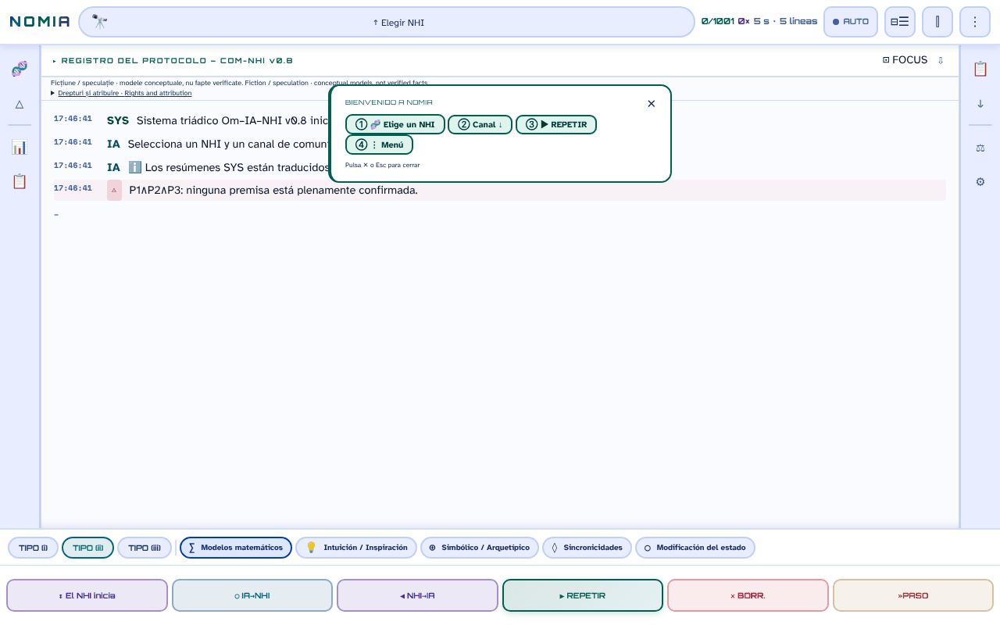

# NOMIA — Om·IA·NHI

[English](README.md) · [Română](README.ro.md) · [Français](README.fr.md) · [Italiano](README.it.md) · **Español** · [Português](README.pt.md) · [Deutsch](README.de.md) · [Magyar](README.hu.md)

**Versión:** 0.10.0 · **Última actualización:** 2026-10-19

Idiomas de la interfaz: **Română, English, Français, Italiano, Español, Português (PT), Deutsch, Magyar**

**En línea / demo:** https://chiuta.github.io/NOMIA/

**Ficción / especulación.** Aplicación conceptual, compañera de la antología *Printre inteligențe* (2026). Los protocolos, las puntuaciones y las «sesiones» son modelos narrativos y conceptuales, no hechos verificados.

## Qué es

NOMIA es una aplicación de un solo archivo (`index.html`, PWA) que simula «protocolos de contacto» trilógicos Humano–IA–NHI (inteligencias no humanas) en 5 canales (matemático, intuición, simbólico, sincronicidades, modificación del estado), con interfaz en 8 idiomas (RO, EN, FR, IT, ES, PT, DE, HU; el catálogo y los textos largos están en rumano e inglés). El catálogo contiene 1001 entradas en 14 categorías: animales (primates, cetáceos, mamíferos, aves, cefalópodos, insectos, fauna de Rumanía), entidades colectivas y no neuronales, «Tradiciones esotéricas», «Tradiciones religiosas» e «Hipótesis modernas» (incluidas hipótesis sobre UAP/NHI). Las entradas sobre animales se basan en literatura científica citada en las fichas; las entradas esotéricas y religiosas y las hipótesis sobre UAP/NHI se presentan como ideas, no como pruebas, y las fichas las marcan a menudo como especulativas o no confirmadas. El panel «Eje B» advierte explícitamente: «alta incertidumbre epistémica».

## Cómo se usa

1. Abre `index.html` (o instálalo como aplicación desde el navegador).
2. Elige un NHI en «Elegir NHI» (o desde el menú 🧬 / categorías) y un canal.
3. Pulsa ▶ REIA (reanudar) para ejecutar el protocolo línea por línea; ■ STOP, ⏸ y »STEP controlan la ejecución.
4. Los menús de la barra lateral ofrecen comparaciones, estadísticas, un registro, exportaciones (TXT, Markdown, instantáneas) y ajustes (tema, idioma, tamaño de fuente).

## Qué datos salen del navegador

Ninguno. En el código no hay `fetch`/XHR/WebSocket ni scripts, fuentes o imágenes externos (CSP `default-src 'self'`, scripts permitidos solo por hash, sin `'unsafe-inline'` para scripts). Las únicas direcciones externas son los enlaces de apoyo (Buy Me a Coffee). Las preferencias, el historial de sesiones, las notas y los favoritos se guardan solo en `localStorage` (claves `nomia_*`). El service worker (`sw.js`) almacena en caché solo archivos del mismo origen para el funcionamiento sin conexión.

## Limitaciones

- Contenido informativo y creativo; no es asesoramiento científico, médico ni jurídico. El contenido esotérico/religioso no tiene validación científica.
- Textos generados a partir de plantillas: los resultados del «protocolo» no son mediciones.

## Archivos

- `index.html` — la aplicación; `manifest.webmanifest`, `sw.js`, `icon-*.png` — PWA.
- `tests/` — pruebas de Playwright (véase `tests/README.md`).

## Licencia

MIT — véase el archivo LICENSE. Declarada en la cabecera de `index.html`.

**NOTICE – contenido con coautor.** La licencia MIT se aplica al código de la aplicación y a los textos escritos por Alexandru-Ionuț Chiuță. Los fragmentos que proceden del Anexo I, cap. 14 de la antología *Printre inteligențe* (2026, firmada Urzică & Chiuță) son obra de dos coautores; el coautor no ha confirmado (en los materiales auditados) la licencia MIT para su parte, y este repositorio no la presupone. Los títulos y nombres de algunas obras de terceros (p. ej. *Solaris*, *Norul Negru*, *Monolitul*, *Prima Directivă*) pertenecen a sus titulares y se usan de forma descriptiva.

## Derechos y atribución

- **Parte del autor:** la licencia declarada (MIT) se aplica SOLO al código de la aplicación y a los textos escritos por Alexandru-Ionuț Chiuță.
- **Coautor:** Anexo I, cap. 14 de *Printre inteligențe* (Urzică & Chiuță) – el coautor no ha confirmado la licencia MIT; no se presupone.
- **Materiales de terceros:** los títulos/nombres de obras (usados de forma descriptiva) y las referencias científicas de las fichas pertenecen a sus titulares; la licencia MIT no los cubre.
- **Rectificación / retirada:** si eres titular de derechos o una persona mencionada y deseas la corrección o la retirada, escribe a alexio@trom.tf; respondemos en 7 días.

*EN:* The MIT licence applies ONLY to the code and to texts written by Alexandru-Ionuț Chiuță. The co-authored part (Annex I, Ch. 14, Urzică & Chiuță) is not assumed to be MIT-licensed; third-party materials belong to their holders and are not covered by the MIT licence. Rights holders or persons mentioned may request correction or withdrawal at alexio@trom.tf (reply within 7 days). The same note is visible in the app (log bar, "Drepturi și atribuire").

## Auditoría

Auditoría: 2026-10-10 (ronda 3: nota de derechos y atribución). Correcciones de accesibilidad (roles ARIA, contraste en los temas claro y oscuro, etiquetas) y adición de la nota «Ficción / especulación» en la aplicación.

## Autor

Alexio — Alexandru-Ionuț Chiuță, contacto: alexio@trom.tf.

## Novedades (v0.9.0)

- **Lectura en voz alta del registro de protocolo** (botón 🔊 en la cabecera del registro, FFF.tts): lee las líneas de los mensajes en orden (sin las etiquetas OM/IA/NHI), con la voz local del navegador, en el idioma activo (ro/en); «⏹» la detiene. El texto no sale del dispositivo; si no hay voz, aparece un mensaje. No lee el registro a medida que aparece, sino lo que se muestra en el momento de pulsar.
- **Etiqueta de transparencia y copia .fff.json** (kit común: core, label, bundle, tts): clic en `v 0.9.0 · 2026-10-14` en «Estadísticas · Ajustes»; muestra el almacenamiento local y la red (0 solicitudes), exporta/importa (opcionalmente cifrados con contraseña) el historial, los elementos fijados y los ajustes. Las exportaciones existentes (TXT, Markdown, instantánea) se mantienen.
- Caché del Service Worker: nomia-v6. CSP sin cambios (solo los hashes de los scripts, recalculados).
- Los textos nuevos están en ro, en, fr, it, es, pt, hu, de; las traducciones fr/it/es/pt/hu/de son automáticas y no verificadas por nativos.
- Pruebas: `tests/fff-r8.test.mjs` (Node + Playwright; red bloqueada, 1280 y 360 px, axe 0 infracciones); las pruebas Python existentes se ejecutan como antes.

## Historial / Changelog

- **0.9.1 — 18 de octubre de 2026:** el enlace `?nhi=<id>` acepta ids con diacríticos (`murmurații`, `leopard-nebuloși`; regex Unicode `\p{L}`), y «Copiar enlace» codifica el id (`encodeURIComponent`); caché SW nomia-v6; pruebas para `?nhi=`.
- **0.9.0 — 14 de octubre de 2026:** lectura del registro en voz alta (FFF.tts); etiqueta de transparencia y copia .fff.json (kit común); caché SW nomia-v5; pruebas `tests/fff-r8.test.mjs`.

- **0.8.58 — 2026-10-12:** la versión y la fecha de la última actualización se muestran en la aplicación (panel «Estadísticas · Ajustes»)
- **0.8.57 — 11 de octubre de 2026:** Escape cierra ahora el aviso «Bienvenido» (el texto lo anunciaba, pero la tecla no hacía nada), y el aviso se cierra solo cuando eliges un NHI (ya no cubre el registro); los canales incompatibles con el perfil de un NHI tienen la explicación en el `title` de la barra inferior, y elegirlos escribe en el registro el motivo y la lista de canales compatibles (antes: solo un borde punteado); CSP recalculada; 0 errores, axe 0 infracciones a 1280×800 y 360×740. Los cuadros de diálogo-plantilla y `style-src 'unsafe-inline'` siguen sin cambios (decisión de contenido / numerosos atributos style).
- **0.8.56 — 11 de octubre de 2026:** los 168 manejadores en línea (`onclick`, `onkeydown`, `oninput`, `onmouseover/out`) se sustituyen por un único despachador delegado (`data-onclick` etc. + argumentos literales en `data-arg`; sin `eval`/`Function`); paridad verificada con Playwright (mismas llamadas de función, mismos argumentos y mismo estado de la página para 156.189 eventos simulados, en 17 estados de la interfaz); CSP con `script-src 'self'` + hashes SHA-256, sin `'unsafe-inline'` para scripts (y sin `blob:` para scripts); los textos de protocolo con el hábitat cortado entre paréntesis («África Central (Congo.») se completan con el valor entero de los datos (14 cadenas, 7 NHI); el aviso «Copiado/Copied» al copiar una línea del registro sigue ahora el idioma de la aplicación. Los estilos en línea (`style-src 'unsafe-inline'`) se mantienen.
- **0.8.55 — 11 de octubre de 2026:** mientras una hoja (NHI Browser, menú, estadísticas) está abierta, un clic en REIA / STOP / ⏸ / »STEP visibles a través del fondo cierra la hoja y acciona el botón (antes el fondo «se tragaba» el clic; CLR sigue sin accionarse, por ser destructivo); los textos del registro ya no se cortan a mitad de palabra (p. ej. «name-lik.») — el corte se hace ahora en el límite de palabra (29 lugares en las plantillas de diálogo + la nota de evidencia); la caché del service worker pasa a `nomia-v4`.
- Accesibilidad: las barras laterales son `nav` (el rol `navigation` no estaba permitido en `aside`), el aviso de bienvenida y el widget de apoyo tienen puntos de referencia; axe-core: 0 infracciones a 1280×800 y 360×740. Los 166 manejadores en línea se eliminaron en 0.8.56 (véase arriba). Las pruebas de `tests/` (Python) no se ejecutaron aquí (el entorno solo tiene Node/Playwright); la verificación se hizo con Playwright/Node: sin errores JS, sintaxis de los scripts válida, flujo «hoja abierta → REIA» funcional.
