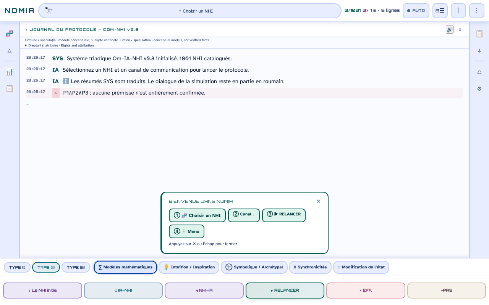

# NOMIA — Om·IA·NHI

[English](README.md) · [Română](README.ro.md) · **Français** · [Italiano](README.it.md) · [Español](README.es.md) · [Português](README.pt.md) · [Deutsch](README.de.md) · [Magyar](README.hu.md)

**Version :** 0.10.18 · **Dernière mise à jour :** 2026-10-26

Langues de l'interface : **Română, English, Français, Italiano, Español, Português (PT), Deutsch, Magyar**

**En ligne / démo :** https://chiuta.github.io/NOMIA/

**Fiction / spéculation.** Application conceptuelle, compagnon de l'anthologie *Printre inteligențe* (2026). Les protocoles, les scores et les « sessions » sont des modèles narratifs et conceptuels, non des faits vérifiés.

## De quoi s'agit-il

NOMIA est une application en un seul fichier (`index.html`, PWA) qui simule des « protocoles de contact » trilogiques Humain–IA–NHI (intelligences non humaines) sur 5 canaux (mathématique, intuition, symbolique, synchronicités, modification de l'état), avec une interface en 8 langues (RO, EN, FR, IT, ES, PT, DE, HU ; les fiches du catalogue et les textes UAP sont entièrement traduits ; les récits des protocoles ne sont traduits qu'en partie (voir « Limites »)). Le catalogue contient 1001 entrées réparties en 14 catégories : animaux (primates, cétacés, mammifères, oiseaux, céphalopodes, insectes, faune de Roumanie), entités collectives et non neuronales, « Traditions ésotériques », « Traditions religieuses » et « Hypothèses modernes » (y compris des hypothèses sur les UAP/NHI). Les entrées sur les animaux reposent sur la littérature scientifique citée dans les fiches ; les entrées ésotériques, religieuses et les hypothèses sur les UAP/NHI sont présentées comme des idées, non comme des preuves, et les fiches les signalent souvent comme spéculatives ou non confirmées. Le panneau « Axe B » avertit explicitement : « incertitude épistémique élevée ».

## Mode d'emploi

1. Ouvrez `index.html` (ou installez-le comme application depuis le navigateur).
2. Choisissez un NHI dans « Choisir un NHI » (ou dans le menu 🧬 / les catégories) et un canal.
3. Appuyez sur ▶ REIA (reprendre) pour exécuter le protocole ligne par ligne ; ■ STOP, ⏸ et »STEP commandent l'exécution.
4. Les menus de la barre latérale proposent des comparaisons, des statistiques, un journal, des exports (TXT, Markdown, instantanés) et des réglages (thème, langue, taille de police).

## Quelles données quittent le navigateur

Aucune. Le code ne contient ni `fetch`/XHR/WebSocket, ni scripts, polices ou images externes (CSP `default-src 'self'`, scripts autorisés uniquement par hash, sans `'unsafe-inline'` pour les scripts). Les seules adresses externes sont les liens de soutien (Buy Me a Coffee). Les préférences, l'historique des sessions, les notes et les favoris sont conservés uniquement dans `localStorage` (clés `nomia_*`). Le service worker (`sw.js`) ne met en cache que des fichiers de la même origine pour le fonctionnement hors ligne.

## Limites

- **Langues :** les fiches du catalogue (lieux, légendes, inconnues, références : 100 %) et les 301 textes UAP sont traduits en fr, it, es, pt, de, hu, de même que la note « Droits et attribution » (RO+EN restent la version de référence). Les récits des protocoles (environ 2,5 millions de caractères affichés) sont désormais traduits presque entièrement : environ 11 500 phrases uniques traduites directement couvrent environ 91 % des caractères des récits (environ 99,6 % en comptant les fragments d'ouverture) ; seul un petit reliquat (environ 0,4 % en comptant les fragments d'ouverture : phrases pas encore traduites) **reste en roumain** dans les autres langues. Les traductions sont automatiques, non vérifiées par des locuteurs natifs ; le contenu religieux, médical (p. ex. migraine de Sacks, Hildegarde, hypothèse de Jaynes, résistance au cancer) et spéculatif/folklorique/UAP, ainsi que la note juridique, **doivent être relus par un spécialiste**.
- Contenu informatif et créatif ; ce n'est pas un conseil scientifique, médical ou juridique. Le contenu ésotérique/religieux n'a pas de validation scientifique.
- Textes générés à partir de modèles : les résultats du « protocole » ne sont pas des mesures.

## Fichiers

- `index.html` — l'application ; `manifest.webmanifest`, `sw.js`, `icon-*.png` — PWA.
- `tests/` — tests Playwright (voir `tests/README.md`).

## Licence

MIT — voir le fichier LICENSE. Déclarée dans l'en-tête de `index.html`.

**NOTICE – contenu à co-auteur.** La licence MIT s'applique au code de l'application et aux textes écrits par Alexandru-Ionuț Chiuță. Les fragments provenant de l'Annexe I, chap. 14 de l'anthologie *Printre inteligențe* (2026, signée Urzică & Chiuță) sont l'œuvre de deux co-auteurs ; le co-auteur n'a pas confirmé (dans les documents audités) la licence MIT pour sa part, et ce dépôt ne la présume pas. Les titres et noms de certaines œuvres de tiers (p. ex. *Solaris*, *Norul Negru*, *Monolitul*, *Prima Directivă*) appartiennent à leurs titulaires et sont utilisés à titre descriptif.

## Droits et attribution

- **Part de l'auteur :** la licence déclarée (MIT) s'applique UNIQUEMENT au code de l'application et aux textes écrits par Alexandru-Ionuț Chiuță.
- **Co-auteur :** Annexe I, chap. 14 de *Printre inteligențe* (Urzică & Chiuță) – le co-auteur n'a pas confirmé la licence MIT ; elle n'est pas présumée.
- **Matériaux de tiers :** les titres/noms d'œuvres (utilisés à titre descriptif) et les références scientifiques des fiches appartiennent à leurs titulaires ; la licence MIT ne les couvre pas.
- **Rectification / retrait :** si vous êtes titulaire de droits ou une personne mentionnée et souhaitez une correction ou un retrait, écrivez à alexio@trom.tf ; nous répondons sous 7 jours.

*EN:* The MIT licence applies ONLY to the code and to texts written by Alexandru-Ionuț Chiuță. The co-authored part (Annex I, Ch. 14, Urzică & Chiuță) is not assumed to be MIT-licensed; third-party materials belong to their holders and are not covered by the MIT licence. Rights holders or persons mentioned may request correction or withdrawal at alexio@trom.tf (reply within 7 days). The same note is visible in the app (log bar, "Drepturi și atribuire").

## Audit

Audit : 2026-10-10 (tour 3 : note de droits et d'attribution). Corrections d'accessibilité (rôles ARIA, contraste dans les thèmes clair et sombre, étiquettes) et ajout de la note « Fiction / spéculation » dans l'application.

## Auteur

Alexio — Alexandru-Ionuț Chiuță, contact : alexio@trom.tf.

## Nouveautés (v0.9.0)

- **Lecture du journal de protocole à voix haute** (bouton 🔊 de l'en-tête du journal, FFF.tts) : lit les lignes des messages dans l'ordre (sans les étiquettes OM/IA/NHI), avec la voix locale du navigateur, dans la langue active (ro/en) ; « ⏹ » l'arrête. Le texte ne quitte pas l'appareil ; s'il n'y a pas de voix, un message s'affiche. Elle ne lit pas le journal au fur et à mesure de son apparition, mais ce qui est affiché au moment de l'appui.
- **Étiquette de transparence et sauvegarde .fff.json** (kit commun : core, label, bundle, tts) : clic sur `v 0.9.0 · 2026-10-14` dans « Statistiques · Réglages » ; elle montre le stockage local et le réseau (0 requête), exporte/importe (éventuellement chiffré par mot de passe) l'historique, les épinglages et les réglages. Les exports existants (TXT, Markdown, instantané) demeurent.
- Cache du Service Worker : nomia-v6. CSP inchangée (uniquement les hashs des scripts, recalculés).
- Les nouveaux textes sont en ro, en, fr, it, es, pt, hu, de ; les traductions fr/it/es/pt/hu/de sont automatiques et non vérifiées par des natifs.
- Tests : `tests/fff-r8.test.mjs` (Node + Playwright ; réseau bloqué, 1280 et 360 px, axe 0 violation) ; les tests Python existants s'exécutent comme avant.

## Historique / Changelog
- **0.10.17 — 2026-10-23 :** Accessibilité : sur écran tactile, les boutons 🔊 (lecture) et défilement automatique restaient à 24 px à cause d’une règle CSS ultérieure ; ils font désormais 44 px.
- **0.10.16 — 2026-10-23:** Stockage : les clés portent désormais le préfixe de l'application (`nomia.a11y`) ; les données existantes sont migrées automatiquement au démarrage depuis les anciennes clés (`a11y`), et les anciennes sauvegardes `.fff.json` s'importent toujours (fff-kit 1.2.0).
- **0.10.14 — 2026-10-22:** Poids : la page passe de 18,6 Mo à 3,3 Mo. Le dictionnaire en 8 langues est découpé en packs de langue (`i18n/keys.js` + un fichier par langue, chargé seulement pour la langue choisie) et les variantes de protocole NHI→Humain / IA→NHI / NHI→IA (2,4 Mo) sont dans `data/variants.js`, chargé à la première utilisation ; le service worker les sert en cache d’abord et, quand la page est inactive, télécharge les autres packs en arrière-plan (sauf avec Save-Data / connexion lente), de sorte que l’application reste entièrement hors ligne. Si un pack ne peut pas être chargé (hors ligne avant son téléchargement), le texte d’origine s’affiche avec un avis dans la langue choisie. Plus de clignotement de texte non traduit (la page apparaît à l’arrivée du pack, au plus après 6 s). Nouveau test : `tests/lazy.test.mjs`.
- **0.10.13 — 2026-10-22 :** fff-kit 1.1.4 : cibles tactiles et taille minimale du texte dans l’interface commune ; cibles tactiles/texte corrigés (boutons de lecture et de défilement auto, enregistrement de la recherche, bandeau de première utilisation, note de droits, libellés des canaux, étiquettes du modèle triadique).
- **0.10.12 — 2026-10-22:** Sécurité : le message « Aucun NHI pour … » et les boutons de recherches enregistrées n’insèrent plus la requête saisie comme HTML (DOM-XSS latent).
- **0.10.11 — 2026-10-22 :** fff-kit 1.1.2 : PBKDF2 600 000 itérations, protection anti-clickjacking.
- **0.10.10 (22 octobre 2026) :** Accessibilité et mobile : un seul H1, noms accessibles sur les 1001 boutons NHI (dérivés du nom de l'entrée) et sur les champs de recherche, texte d'au moins 12 px sur les cartes et filtres ; confirm() remplacé par des dialogues intégrés traduits ; les exports CSV neutralisent les préfixes de formule (=, +, -, @).
- **0.10.9 — 2026-10-22 :** les 1001 noms d'entités (p. ex. « Girafes », « L'hypothèse du zoo », « Autruches d'Afrique ») sont désormais traduits en fr/it/es/pt/de/hu dans la liste, la recherche et les fiches ; le tableau et le panneau de détails des UAP, les infobulles des canaux et le journal de démarrage n'affichent plus de roumain (ni d'anglais en roumain).
- **0.10.8 — 2026-10-22 :** le titre, la note de droits et les noms de catégories (traditions ésotériques/religieuses, hypothèses modernes, céphalopodes) suivent désormais la langue de l'interface.
- **0.10.7 — 2026-10-22 :** la validation des traductions accepte désormais le format local des nombres (10.000 / 10,000 / 10 000, 1.2 / 1,2) et les nombres rendus en lettres ou en ordinaux ; environ 320 phrases précédemment rejetées ont été revues et intégrées (toutes des traductions correctes : nombres en toutes lettres, format horaire, siècles en chiffres romains, échelle des « trillions ») : environ 11 500 phrases uniques, environ 91 % des caractères des récits (environ 99,6 % en comptant les fragments d'ouverture) ; plus aucune phrase n'est rejetée à la validation.
- **0.10.6 — 2026-10-21 :** les récits des protocoles sont désormais traduits en fr, it, es, pt, de, hu presque entièrement : environ 11 400 phrases uniques traduites directement, soit environ 91 % des caractères des récits (environ 99 % en comptant les fragments d'ouverture) ; seul un petit reliquat reste en roumain. Les traductions sont automatiques, non vérifiées par des locuteurs natifs, et doivent être relues par un spécialiste (contenu religieux, médical, spéculatif/folklorique/UAP et note juridique).
- **0.10.5 — 2026-10-19 :** la note « Droits et attribution » est traduite en fr, it, es, pt, de, hu (RO+EN restent la version de référence) ; séparateur de phrases et 105 modèles à emplacements supplémentaires, plus 277 phrases traduites : environ 59 % des caractères des récits de protocole sont désormais traduits (68 % en comptant les fragments d'ouverture). Les traductions doivent être relues par un spécialiste (juridique).
- **0.10.4 — 2026-10-19 :** les fiches du catalogue et les textes UAP sont traduits en fr, it, es, pt, de, hu ; repli au niveau de la phrase pour les 331 modèles narratifs les plus fréquents (environ la moitié des caractères des récits). **0.10.1 :** les bandeaux d'annulation / de première utilisation et le toast retrouvent leur décalage en bas et leur largeur (`calc()` invalide).
- **0.9.1 — 18 octobre 2026 :** le lien `?nhi=<id>` accepte les identifiants avec diacritiques (`murmurații`, `leopard-nebuloși` ; regex Unicode `\p{L}`), et « Copier le lien » encode l'identifiant (`encodeURIComponent`) ; cache SW nomia-v6 ; tests pour `?nhi=`.
- **0.9.0 — 14 octobre 2026 :** lecture du journal à voix haute (FFF.tts) ; étiquette de transparence et sauvegarde .fff.json (kit commun) ; cache SW nomia-v5 ; tests `tests/fff-r8.test.mjs`.

- **0.8.58 — 2026-10-12 :** la version et la date de la dernière mise à jour s'affichent dans l'application (panneau « Statistiques · Réglages »)
- **0.8.57 — 11 octobre 2026 :** Échap ferme désormais la bannière « Bienvenue » (le texte l'annonçait, mais la touche ne faisait rien), et la bannière se ferme d'elle-même quand vous choisissez un NHI (elle ne couvre plus le journal) ; les canaux incompatibles avec le profil d'un NHI ont l'explication dans le `title` de la barre du bas, et leur choix écrit dans le journal le motif et la liste des canaux compatibles (avant : seulement un contour en pointillés) ; CSP recalculée ; 0 erreur, axe 0 violation à 1280×800 et 360×740. Les boîtes de dialogue-modèles et `style-src 'unsafe-inline'` restent inchangés (décision de contenu / nombreux attributs style).
- **0.8.56 — 11 octobre 2026 :** les 168 gestionnaires en ligne (`onclick`, `onkeydown`, `oninput`, `onmouseover/out`) sont remplacés par un seul répartiteur délégué (`data-onclick` etc. + arguments littéraux dans `data-arg` ; sans `eval`/`Function`) ; parité vérifiée avec Playwright (mêmes appels de fonctions, mêmes arguments et même état de la page pour 156 189 événements simulés, sur 17 états de l'interface) ; CSP avec `script-src 'self'` + hashs SHA-256, sans `'unsafe-inline'` pour les scripts (et sans `blob:` pour les scripts) ; les textes de protocole dont l'habitat était coupé entre parenthèses (« Afrique centrale (Congo. ») sont complétés par la valeur entière issue des données (14 chaînes, 7 NHI) ; le toast « Copié/Copied » lors de la copie d'une ligne du journal suit désormais la langue de l'application. Les styles en ligne (`style-src 'unsafe-inline'`) demeurent.
- **0.8.55 — 11 octobre 2026 :** tant qu'une feuille (NHI Browser, menu, statistiques) est ouverte, un clic sur REIA / STOP / ⏸ / »STEP visibles à travers l'arrière-plan ferme la feuille et active le bouton (avant, l'arrière-plan « avalait » le clic ; CLR reste sans action, étant destructif) ; les textes du journal ne sont plus coupés au milieu des mots (p. ex. « name-lik. ») — la coupure se fait désormais à une limite de mot (29 endroits dans les modèles de dialogue + la note de preuve) ; le cache du service worker devient `nomia-v4`.
- Accessibilité : les barres latérales sont des `nav` (le rôle `navigation` n'était pas autorisé sur `aside`), la bannière de bienvenue et le widget de soutien ont des repères ; axe-core : 0 violation à 1280×800 et 360×740. Les 166 gestionnaires en ligne ont été supprimés en 0.8.56 (voir ci-dessus). Les tests de `tests/` (Python) n'ont pas été exécutés ici (l'environnement n'a que Node/Playwright) ; la vérification a été faite avec Playwright/Node : pas d'erreurs JS, syntaxe des scripts valide, flux « feuille ouverte → REIA » fonctionnel.
