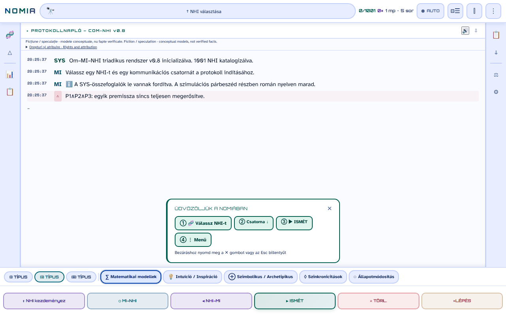

# NOMIA — Om·IA·NHI

[English](README.md) · [Română](README.ro.md) · [Français](README.fr.md) · [Italiano](README.it.md) · [Español](README.es.md) · [Português](README.pt.md) · [Deutsch](README.de.md) · **Magyar**

**Verzió:** 0.10.13 · **Utolsó frissítés:** 2026-10-22

A felület nyelvei: **Română, English, Français, Italiano, Español, Português (PT), Deutsch, Magyar**

**Élő változat / demó:** https://chiuta.github.io/NOMIA/

**Fikció / spekuláció.** Koncepcionális alkalmazás, a *Printre inteligențe* (2026) antológia kísérője. A protokollok, pontszámok és „munkamenetek” narratív és koncepcionális modellek, nem ellenőrzött tények.

## Mi ez

A NOMIA egyetlen fájlból álló alkalmazás (`index.html`, PWA), amely trilógikus Ember–MI–NHI (nem emberi intelligenciák) „kapcsolatfelvételi protokollokat” szimulál 5 csatornán (matematikai, intuíció, szimbolikus, szinkronicitások, tudatállapot-módosítás), 8 nyelvű felülettel (RO, EN, FR, IT, ES, PT, DE, HU; a katalóguslapok és az UAP-szövegek teljesen le vannak fordítva; a protokollok elbeszélései csak részben vannak lefordítva (lásd a „Korlátok” szakaszt)). A katalógus 1001 bejegyzést tartalmaz 14 kategóriában: állatok (főemlősök, cetfélék, emlősök, madarak, fejlábúak, rovarok, Románia faunája), kollektív és nem neuronális entitások, „Ezoterikus hagyományok”, „Vallási hagyományok” és „Modern hipotézisek” (az UAP/NHI-ra vonatkozó hipotéziseket is beleértve). Az állatokról szóló bejegyzések a lapokon idézett tudományos szakirodalomra támaszkodnak; az ezoterikus és vallási bejegyzések, valamint az UAP/NHI-hipotézisek ötletként, nem bizonyítékként jelennek meg, és a lapok gyakran spekulatívnak vagy meg nem erősítettnek jelölik őket. A „B tengely” panel kifejezetten figyelmeztet: „magas episztemikus bizonytalanság”.

## Hogyan használható

1. Nyissa meg az `index.html` fájlt (vagy telepítse alkalmazásként a böngészőből).
2. Válasszon NHI-t a „NHI kiválasztása” menüből (vagy a 🧬 menüből / kategóriákból) és egy csatornát.
3. Nyomja meg a ▶ REIA (folytatás) gombot a protokoll soronkénti futtatásához; a ■ STOP, ⏸ és »STEP vezérli a futást.
4. Az oldalsáv menüi összehasonlításokat, statisztikákat, naplót, exportokat (TXT, Markdown, pillanatképek) és beállításokat (téma, nyelv, betűméret) kínálnak.

## Milyen adatok hagyják el a böngészőt

Semmilyen. A kódban nincs `fetch`/XHR/WebSocket, sem külső szkript, betűtípus vagy kép (CSP `default-src 'self'`, a szkriptek csak hash alapján engedélyezettek, szkriptekhez nincs `'unsafe-inline'`). Az egyetlen külső címek a támogatási hivatkozások (Buy Me a Coffee). A beállítások, a munkamenet-előzmények, a jegyzetek és a kedvencek csak a `localStorage`-ban tárolódnak (`nomia_*` kulcsok). A service worker (`sw.js`) csak az azonos eredetű fájlokat tárolja gyorsítótárban az offline működéshez.

## Korlátok

- **Nyelvek:** a katalóguslapok (helyszínek, feliratok, ismeretlenek, hivatkozások: 100%) és a 301 UAP-szöveg le van fordítva fr, it, es, pt, de, hu nyelvre, csakúgy, mint a „Jogok és forrásmegjelölés” megjegyzés (az RO+EN marad a referenciaváltozat). A protokollok elbeszélései (kb. 2,5 millió megjelenített karakter) most már szinte teljesen le vannak fordítva: kb. 11 500 egyedi, közvetlenül lefordított mondat az elbeszélés-karakterek kb. 91%-át fedi le (kb. 99,6%-át, ha a bevezető töredékeket is számoljuk); csak egy kis maradék (kb. 0,4% a bevezető töredékekkel együtt: még le nem fordított mondatok) a többi nyelven **románul marad**. A fordítások automatikusak, anyanyelvi beszélők nem ellenőrizték; a vallási, orvosi (pl. Sacks-migrén, Hildegard, Jaynes-hipotézis, rákrezisztencia) és spekulatív/népi/UAP-tartalom, valamint a jogi megjegyzés **szakmai felülvizsgálatot igényel**.
- Tájékoztató és kreatív tartalom; nem tudományos, orvosi vagy jogi tanács. Az ezoterikus/vallási tartalomnak nincs tudományos érvényesítése.
- Sablonokból generált szövegek: a „protokoll” eredményei nem mérések.

## Fájlok

- `index.html` — az alkalmazás; `manifest.webmanifest`, `sw.js`, `icon-*.png` — PWA.
- `tests/` — Playwright-tesztek (lásd `tests/README.md`).

## Licenc

MIT — lásd a LICENSE fájlt. Az `index.html` fejlécében van deklarálva.

**NOTICE – társszerzős tartalom.** Az MIT licenc az alkalmazás kódjára és Alexandru-Ionuț Chiuță által írt szövegekre vonatkozik. A *Printre inteligențe* (2026, Urzică & Chiuță aláírásával) antológia I. mellékletének 14. fejezetéből származó részletek két társszerző művei; a társszerző (az auditált anyagokban) nem erősítette meg az MIT-licencelést a saját részére, és ez a tárhely ezt nem feltételezi. Egyes harmadik felek műveinek címei és nevei (pl. *Solaris*, *Norul Negru*, *Monolitul*, *Prima Directivă*) jogtulajdonosaikat illetik, és leíró módon szerepelnek.

## Jogok és forrásmegjelölés

- **A szerző része:** a deklarált licenc (MIT) KIZÁRÓLAG az alkalmazás kódjára és az Alexandru-Ionuț Chiuță által írt szövegekre vonatkozik.
- **Társszerző:** a *Printre inteligențe* I. mellékletének 14. fejezete (Urzică & Chiuță) – a társszerző nem erősítette meg az MIT-licencelést; ezt nem feltételezzük.
- **Harmadik felek anyagai:** a művek címei/nevei (leíró módon használva) és a lapokon szereplő tudományos hivatkozások jogtulajdonosaikat illetik; az MIT licenc nem terjed ki rájuk.
- **Helyesbítés / visszavonás:** ha Ön jogtulajdonos vagy említett személy, és helyesbítést vagy visszavonást kér, írjon az alexio@trom.tf címre; 7 napon belül válaszolunk.

*EN:* The MIT licence applies ONLY to the code and to texts written by Alexandru-Ionuț Chiuță. The co-authored part (Annex I, Ch. 14, Urzică & Chiuță) is not assumed to be MIT-licensed; third-party materials belong to their holders and are not covered by the MIT licence. Rights holders or persons mentioned may request correction or withdrawal at alexio@trom.tf (reply within 7 days). The same note is visible in the app (log bar, "Drepturi și atribuire").

## Audit

Audit: 2026-10-10 (3. kör: jogi és forrásmegjelölési megjegyzés). Akadálymentességi javítások (ARIA-szerepkörök, kontraszt a világos és a sötét témában, feliratok) és a „Fikció / spekuláció” megjegyzés hozzáadása az alkalmazásban.

## Szerző

Alexio — Alexandru-Ionuț Chiuță, kapcsolat: alexio@trom.tf.

## Újdonságok (v0.9.0)

- **A protokollnapló felolvasása** (🔊 gomb a napló fejlécében, FFF.tts): sorrendben felolvassa az üzenetsorokat (az OM/IA/NHI címkék nélkül), a böngésző helyi hangjával, az aktív nyelven (ro/en); a „⏹” leállítja. A szöveg nem hagyja el az eszközt; ha nincs hang, üzenet jelenik meg. Nem a naplót olvassa fel a megjelenésükkor, hanem azt, ami a gombnyomás pillanatában látható.
- **Átláthatósági címke és .fff.json mentés** (közös kit: core, label, bundle, tts): kattintás a `v 0.9.0 · 2026-10-14` feliratra a „Statisztika · Beállítások” részben; megmutatja a helyi tárolást és a hálózatot (0 kérés), exportálja/importálja (opcionálisan jelszóval titkosítva) az előzményeket, a rögzítéseket és a beállításokat. A meglévő exportok (TXT, Markdown, pillanatkép) megmaradnak.
- Service Worker gyorsítótár: nomia-v6. A CSP változatlan (csak a szkript-hashek, újraszámolva).
- Az új szövegek ro, en, fr, it, es, pt, hu, de nyelven vannak; az fr/it/es/pt/hu/de fordítások automatikusak, és anyanyelvi ellenőrzés nélküliek.
- Tesztek: `tests/fff-r8.test.mjs` (Node + Playwright; hálózat blokkolva, 1280 és 360 px, axe 0 szabálysértés); a meglévő Python-tesztek a korábbiak szerint futnak.

## Előzmények / Changelog
- **0.10.13 — 2026-10-22:** fff-kit 1.1.4: érintési célok és minimális szövegméret a közös felületen; javított érintési célok/szöveg (felolvasó és automatikus görgetés gombok, keresés mentése, első használati sáv, jogi megjegyzés, csatornacímkék, a triadikus modell címkéi).
- **0.10.12 — 2026-10-22:** Biztonság: a „Nincs NHI erre: …” üzenet és a mentett keresések gombjai már nem szúrják be HTML-ként a beírt keresőkifejezést (látens DOM-XSS).
- **0.10.11 — 2026-10-22:** fff-kit 1.1.2: PBKDF2 600 000 iteráció, clickjacking elleni védelem.
- **0.10.10 (2026. október 22.):** Akadálymentesség és mobil: pontosan egy H1, elérhető nevek az 1001 NHI-gombon (a bejegyzés nevéből származtatva) és a keresőmezőkön, legalább 12 px szöveg a kártyákon és szűrőkön; a confirm() helyett lefordított beágyazott párbeszédablakok; a CSV-exportok semlegesítik a képletelőtagokat (=, +, -, @).
- **0.10.9 — 2026-10-22:** az 1001 entitásnév (pl. „Zsiráfok”, „Az Állatkert-hipotézis”, „Afrikai struccok”) mostantól fr/it/es/pt/de/hu nyelven is lefordítva jelenik meg a listában, a keresésben és a lapokon; az UAP-esettábla és a részletpanel, a csatornák súgószövege és az indítási napló már nem mutat románt (vagy angolt román nyelven).
- **0.10.8 — 2026-10-22:** a cím, a jogi megjegyzés és a kategórianevek (ezoterikus/vallási hagyományok, modern hipotézisek, fejlábúak) mostantól a felület nyelvét követik.
- **0.10.7 — 2026-10-22:** a fordítások ellenőrzése mostantól elfogadja a helyi számformátumot (10.000 / 10,000 / 10 000, 1.2 / 1,2) és a betűvel vagy sorszámnévvel kifejezett számokat; kb. 320 korábban elutasított mondatot átnéztünk és beépítettünk (mind helyes fordítás: betűvel írt számok, órabeosztás, római számos századok, a „trillió” számskála): kb. 11 500 egyedi mondat, az elbeszélés-karakterek kb. 91%-a (kb. 99,6%-a a bevezető töredékekkel); az ellenőrzés már egyetlen mondatot sem utasít el.
- **0.10.6 — 2026-10-21:** a protokollok elbeszélései most már szinte teljesen le vannak fordítva fr, it, es, pt, de, hu nyelvre: kb. 11 400 egyedi, közvetlenül lefordított mondat, az elbeszélés-karakterek kb. 91%-a (kb. 99%-a a bevezető töredékekkel); csak egy kis maradék marad románul. A fordítások automatikusak, anyanyelvi beszélők nem ellenőrizték, és szakmai felülvizsgálatot igényelnek (vallási, orvosi, spekulatív/népi/UAP-tartalom és a jogi megjegyzés).
- **0.10.5 — 2026-10-19:** a „Jogok és forrásmegjelölés” megjegyzés le van fordítva fr, it, es, pt, de, hu nyelvre (az RO+EN marad a referenciaváltozat); mondatfelosztó és további 105 helyőrzős sablon, valamint 277 lefordított mondat: a protokollok elbeszélés-karaktereinek kb. 59%-a van most lefordítva (68%, ha a bevezető töredékeket is számoljuk). A fordítások szakmai (jogi) felülvizsgálatot igényelnek.
- **0.10.4 — 2026-10-19:** a katalóguslapok és az UAP-szövegek le vannak fordítva fr, it, es, pt, de, hu nyelvre; mondatszintű tartalék a 331 leggyakoribb elbeszélősablonhoz (az elbeszélés-karakterek kb. fele). **0.10.1:** a visszavonás / első használat szalagok és a toast visszakapják az alsó eltolást és a szélességet (érvénytelen `calc()`).
- **0.9.1 — 2026. október 18.:** a `?nhi=<id>` hivatkozás elfogad ékezetes azonosítókat (`murmurații`, `leopard-nebuloși`; Unicode regex `\p{L}`), a „Hivatkozás másolása” pedig kódolja az azonosítót (`encodeURIComponent`); SW gyorsítótár nomia-v6; tesztek a `?nhi=` paraméterhez.
- **0.9.0 — 2026. október 14.:** a napló felolvasása (FFF.tts); átláthatósági címke és .fff.json mentés (közös kit); SW gyorsítótár nomia-v5; `tests/fff-r8.test.mjs` tesztek.

- **0.8.58 — 2026-10-12:** a verzió és az utolsó frissítés dátuma megjelenik az alkalmazásban („Statisztika · Beállítások” panel)
- **0.8.57 — 2026. október 11.:** az Escape mostantól bezárja az „Üdvözöljük” sávot (a szöveg ezt ígérte, de a billentyű nem csinált semmit), és a sáv magától bezárul, amikor NHI-t választ (már nem takarja a naplót); az NHI profiljával inkompatibilis csatornák magyarázata az alsó sáv `title` attribútumában van, és kiválasztásuk a naplóba írja az okot és a kompatibilis csatornák listáját (korábban: csak pontozott szegély); CSP újraszámolva; 0 hiba, axe 0 szabálysértés 1280×800 és 360×740 méretnél. A sablonpárbeszédek és a `style-src 'unsafe-inline'` változatlanok maradnak (tartalmi döntés / sok style attribútum).
- **0.8.56 — 2026. október 11.:** a 168 beágyazott eseménykezelő (`onclick`, `onkeydown`, `oninput`, `onmouseover/out`) helyére egyetlen delegált diszpécser lépett (`data-onclick` stb. + szó szerinti argumentumok a `data-arg`-ban; `eval`/`Function` nélkül); a paritást Playwrighttal ellenőrizték (azonos függvényhívások, azonos argumentumok és azonos oldalállapot 156 189 szimulált eseményre, a felület 17 állapotában); CSP `script-src 'self'` + SHA-256 hashekkel, szkriptekhez `'unsafe-inline'` nélkül (és `blob:` nélkül a szkriptekhez); a zárójelben elvágott élőhelyű protokollszövegek („Közép-Afrika (Kongó.”) kiegészítésre kerültek az adatok teljes értékével (14 karakterlánc, 7 NHI); a „Másolva/Copied” értesítés egy naplósor másolásakor mostantól az alkalmazás nyelvét követi. A beágyazott stílusok (`style-src 'unsafe-inline'`) megmaradnak.
- **0.8.55 — 2026. október 11.:** amíg egy lap (NHI Browser, menü, statisztika) nyitva van, a háttéren át látható REIA / STOP / ⏸ / »STEP gombra kattintás bezárja a lapot és működteti a gombot (korábban a háttér „elnyelte” a kattintást; a CLR nem aktiválódik, mert romboló); a naplóban a szövegek már nem szó közepén vágódnak el (pl. „name-lik.”) — a vágás mostantól szóhatáron történik (29 helyen a párbeszédsablonokban + a bizonyítékjegyzet); a service worker gyorsítótára `nomia-v4` lesz.
- Akadálymentesség: az oldalsávok `nav` elemek (a `navigation` szerepkör nem volt engedélyezett `aside`-on), az üdvözlősáv és a támogatási widget eligazodási pontokat kapott; axe-core: 0 szabálysértés 1280×800 és 360×740 méretnél. A 166 beágyazott eseménykezelő eltávolításra került a 0.8.56-ban (lásd fent). A `tests/` mappa (Python) tesztjeit itt nem futtatták (a környezetben csak Node/Playwright van); az ellenőrzés Playwrighttal/Node-dal történt: nincs JS-hiba, a szkriptek szintaxisa érvényes, a „nyitott lap → REIA” folyamat működik.
