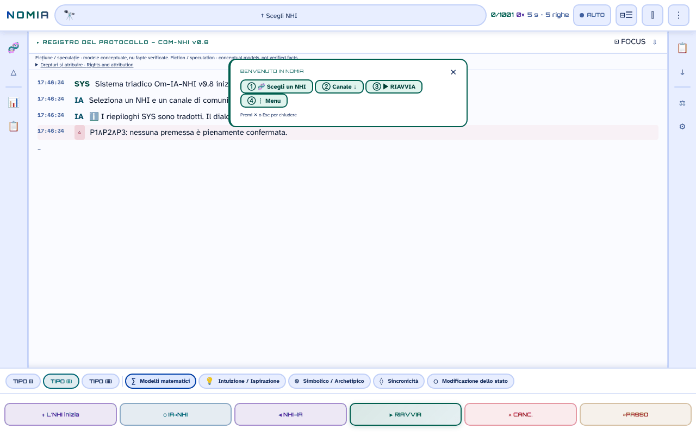

# NOMIA — Om·IA·NHI

[English](README.md) · [Română](README.ro.md) · [Français](README.fr.md) · **Italiano** · [Español](README.es.md) · [Português](README.pt.md) · [Deutsch](README.de.md) · [Magyar](README.hu.md)

**Versione:** 0.10.3 · **Ultimo aggiornamento:** 2026-10-19

Lingue dell'interfaccia: **Română, English, Français, Italiano, Español, Português (PT), Deutsch, Magyar**

**Online / demo:** https://chiuta.github.io/NOMIA/

**Finzione / speculazione.** Applicazione concettuale, compagna dell'antologia *Printre inteligențe* (2026). I protocolli, i punteggi e le «sessioni» sono modelli narrativi e concettuali, non fatti verificati.

## Cos'è

NOMIA è un'applicazione in un unico file (`index.html`, PWA) che simula «protocolli di contatto» trilogici Uomo–IA–NHI (intelligenze non umane) su 5 canali (matematico, intuizione, simbolico, sincronicità, modifica dello stato), con interfaccia in 8 lingue (RO, EN, FR, IT, ES, PT, DE, HU; il catalogo e i testi lunghi sono in rumeno e inglese). Il catalogo contiene 1001 voci in 14 categorie: animali (primati, cetacei, mammiferi, uccelli, cefalopodi, insetti, fauna della Romania), entità collettive e non neuronali, «Tradizioni esoteriche», «Tradizioni religiose» e «Ipotesi moderne» (comprese ipotesi su UAP/NHI). Le voci sugli animali si basano sulla letteratura scientifica citata nelle schede; le voci esoteriche e religiose e le ipotesi su UAP/NHI sono presentate come idee, non come prove, e le schede le segnalano spesso come speculative o non confermate. Il pannello «Asse B» avverte esplicitamente: «elevata incertezza epistemica».

## Come si usa

1. Apri `index.html` (o installalo come applicazione dal browser).
2. Scegli un NHI da «Scegli NHI» (o dal menu 🧬 / categorie) e un canale.
3. Premi ▶ REIA (riprendi) per eseguire il protocollo riga per riga; ■ STOP, ⏸ e »STEP controllano l'esecuzione.
4. I menu della barra laterale offrono confronti, statistiche, un registro, esportazioni (TXT, Markdown, istantanee) e impostazioni (tema, lingua, dimensione del carattere).

## Quali dati lasciano il browser

Nessuno. Nel codice non ci sono `fetch`/XHR/WebSocket né script, font o immagini esterni (CSP `default-src 'self'`, script consentiti solo tramite hash, senza `'unsafe-inline'` per gli script). Gli unici indirizzi esterni sono i link di sostegno (Buy Me a Coffee). Le preferenze, la cronologia delle sessioni, le note e i preferiti sono conservati solo in `localStorage` (chiavi `nomia_*`). Il service worker (`sw.js`) mette in cache solo file della stessa origine per il funzionamento offline.

## Limiti

- Contenuto informativo e creativo; non è un consiglio scientifico, medico o legale. Il contenuto esoterico/religioso non ha validazione scientifica.
- Testi generati da modelli: i risultati del «protocollo» non sono misurazioni.

## File

- `index.html` — l'applicazione; `manifest.webmanifest`, `sw.js`, `icon-*.png` — PWA.
- `tests/` — test Playwright (vedi `tests/README.md`).

## Licenza

MIT — vedi il file LICENSE. Dichiarata nell'intestazione di `index.html`.

**NOTICE – contenuto con coautore.** La licenza MIT si applica al codice dell'applicazione e ai testi scritti da Alexandru-Ionuț Chiuță. I frammenti provenienti dall'Allegato I, cap. 14 dell'antologia *Printre inteligențe* (2026, firmata Urzică & Chiuță) sono opera di due coautori; il coautore non ha confermato (nei materiali sottoposti ad audit) la licenza MIT per la sua parte, e questo repository non la presuppone. I titoli e i nomi di alcune opere di terzi (ad es. *Solaris*, *Norul Negru*, *Monolitul*, *Prima Directivă*) appartengono ai rispettivi titolari e sono usati a scopo descrittivo.

## Diritti e attribuzione

- **Parte dell'autore:** la licenza dichiarata (MIT) si applica SOLO al codice dell'applicazione e ai testi scritti da Alexandru-Ionuț Chiuță.
- **Coautore:** Allegato I, cap. 14 di *Printre inteligențe* (Urzică & Chiuță) – il coautore non ha confermato la licenza MIT; non è presupposta.
- **Materiali di terzi:** titoli/nomi di opere (usati a scopo descrittivo) e riferimenti scientifici nelle schede appartengono ai rispettivi titolari; la licenza MIT non li copre.
- **Rettifica / ritiro:** se sei titolare di diritti o una persona menzionata e desideri la correzione o il ritiro, scrivi a alexio@trom.tf; rispondiamo entro 7 giorni.

*EN:* The MIT licence applies ONLY to the code and to texts written by Alexandru-Ionuț Chiuță. The co-authored part (Annex I, Ch. 14, Urzică & Chiuță) is not assumed to be MIT-licensed; third-party materials belong to their holders and are not covered by the MIT licence. Rights holders or persons mentioned may request correction or withdrawal at alexio@trom.tf (reply within 7 days). The same note is visible in the app (log bar, "Drepturi și atribuire").

## Audit

Audit: 2026-10-10 (round 3: nota su diritti e attribuzione). Correzioni di accessibilità (ruoli ARIA, contrasto nei temi chiaro e scuro, etichette) e aggiunta della nota «Finzione / speculazione» nell'applicazione.

## Autore

Alexio — Alexandru-Ionuț Chiuță, contatto: alexio@trom.tf.

## Novità (v0.9.0)

- **Lettura ad alta voce del registro del protocollo** (pulsante 🔊 nell'intestazione del registro, FFF.tts): legge le righe dei messaggi in ordine (senza le etichette OM/IA/NHI), con la voce locale del browser, nella lingua attiva (ro/en); «⏹» la ferma. Il testo non lascia il dispositivo; se non c'è una voce, compare un messaggio. Non legge il registro man mano che compare, ma ciò che è mostrato nel momento della pressione.
- **Etichetta di trasparenza e copia .fff.json** (kit comune: core, label, bundle, tts): clic su `v 0.9.0 · 2026-10-14` in «Statistiche · Impostazioni»; mostra l'archiviazione locale e la rete (0 richieste), esporta/importa (opzionalmente cifrati con password) cronologia, elementi fissati e impostazioni. Le esportazioni esistenti (TXT, Markdown, istantanea) restano.
- Cache del Service Worker: nomia-v6. CSP invariata (solo gli hash degli script, ricalcolati).
- I nuovi testi sono in ro, en, fr, it, es, pt, hu, de; le traduzioni fr/it/es/pt/hu/de sono automatiche e non verificate da madrelingua.
- Test: `tests/fff-r8.test.mjs` (Node + Playwright; rete bloccata, 1280 e 360 px, axe 0 violazioni); i test Python esistenti girano come prima.

## Storico / Changelog

- **0.9.1 — 18 ottobre 2026:** il link `?nhi=<id>` accetta id con segni diacritici (`murmurații`, `leopard-nebuloși`; regex Unicode `\p{L}`), e «Copia link» codifica l'id (`encodeURIComponent`); cache SW nomia-v6; test per `?nhi=`.
- **0.9.0 — 14 ottobre 2026:** lettura del registro ad alta voce (FFF.tts); etichetta di trasparenza e copia .fff.json (kit comune); cache SW nomia-v5; test `tests/fff-r8.test.mjs`.

- **0.8.58 — 2026-10-12:** la versione e la data dell'ultimo aggiornamento sono mostrate nell'applicazione (pannello «Statistiche · Impostazioni»)
- **0.8.57 — 11 ottobre 2026:** Escape ora chiude il banner «Benvenuto» (il testo lo annunciava, ma il tasto non faceva nulla), e il banner si chiude da solo quando scegli un NHI (non copre più il registro); i canali incompatibili con il profilo di un NHI hanno la spiegazione nel `title` nella barra inferiore, e la loro scelta scrive nel registro il motivo e l'elenco dei canali compatibili (prima: solo un bordo tratteggiato); CSP ricalcolata; 0 errori, axe 0 violazioni a 1280×800 e 360×740. Le finestre-modello e `style-src 'unsafe-inline'` restano invariati (decisione di contenuto / numerosi attributi style).
- **0.8.56 — 11 ottobre 2026:** i 168 gestori inline (`onclick`, `onkeydown`, `oninput`, `onmouseover/out`) sono sostituiti da un unico dispatcher delegato (`data-onclick` ecc. + argomenti letterali in `data-arg`; senza `eval`/`Function`); parità verificata con Playwright (stesse chiamate di funzione, stessi argomenti e stesso stato della pagina per 156.189 eventi simulati, su 17 stati dell'interfaccia); CSP con `script-src 'self'` + hash SHA-256, senza `'unsafe-inline'` per gli script (e senza `blob:` per gli script); i testi di protocollo con l'habitat tagliato tra parentesi («Africa centrale (Congo.») sono completati con il valore intero dai dati (14 stringhe, 7 NHI); il toast «Copiato/Copied» alla copia di una riga del registro segue ora la lingua dell'applicazione. Gli stili inline (`style-src 'unsafe-inline'`) restano.
- **0.8.55 — 11 ottobre 2026:** finché un foglio (NHI Browser, menu, statistiche) è aperto, un clic su REIA / STOP / ⏸ / »STEP visibili attraverso lo sfondo chiude il foglio e aziona il pulsante (prima lo sfondo «inghiottiva» il clic; CLR resta non azionato, essendo distruttivo); i testi nel registro non vengono più tagliati a metà parola (ad es. «name-lik.») — il taglio avviene ora al limite di parola (29 punti nei modelli di dialogo + la nota di evidenza); la cache del service worker diventa `nomia-v4`.
- Accessibilità: le barre laterali sono `nav` (il ruolo `navigation` non era consentito su `aside`), il banner di benvenuto e il widget di sostegno hanno punti di riferimento; axe-core: 0 violazioni a 1280×800 e 360×740. I 166 gestori inline sono stati rimossi in 0.8.56 (vedi sopra). I test in `tests/` (Python) non sono stati eseguiti qui (l'ambiente ha solo Node/Playwright); la verifica è stata fatta con Playwright/Node: nessun errore JS, sintassi degli script valida, flusso «foglio aperto → REIA» funzionante.
