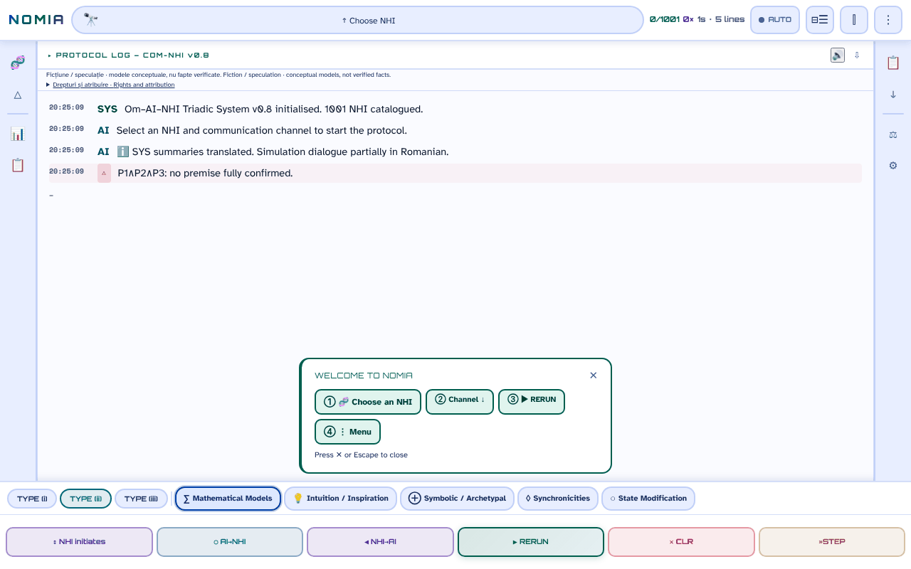

# NOMIA — Om·IA·NHI

**English** · [Română](README.ro.md) · [Français](README.fr.md) · [Italiano](README.it.md) · [Español](README.es.md) · [Português](README.pt.md) · [Deutsch](README.de.md) · [Magyar](README.hu.md)

**Version:** 0.10.18 · **Last updated:** 2026-10-26

Interface languages: **Română, English, Français, Italiano, Español, Português (PT), Deutsch, Magyar**

**Live / demo:** https://chiuta.github.io/NOMIA/

**Fiction / speculation.** A conceptual application, companion to the anthology *Printre inteligențe* (2026). The protocols, scores and "sessions" are narrative and conceptual models, not verified facts.

## What it is

NOMIA is a single-file application (`index.html`, PWA) that simulates trilogic Human–AI–NHI (non-human intelligences) "contact protocols" across 5 channels (mathematical, intuition, symbolic, synchronicities, altered state), with an interface in 8 languages (RO, EN, FR, IT, ES, PT, DE, HU; the catalog sheets and the UAP texts are fully translated; the protocol narratives are only partly translated (see "Limitations")). The catalog contains 1001 entries in 14 categories: animals (primates, cetaceans, mammals, birds, cephalopods, insects, fauna of Romania), collective and non-neuronal entities, "Esoteric traditions", "Religious traditions" and "Modern hypotheses" (including hypotheses about UAP/NHI). The entries about animals are based on scientific literature cited in the sheets; the esoteric and religious entries and the UAP/NHI hypotheses are presented as ideas, not as evidence, and the sheets often mark them as speculative or unconfirmed. The "Axis B" panel explicitly warns: "high epistemic uncertainty".

## How to use

1. Open `index.html` (or install it as an app from the browser).
2. Choose an NHI from "Choose NHI" (or from the 🧬 menu / categories) and a channel.
3. Press ▶ REIA (resume) to run the protocol line by line; ■ STOP, ⏸ and »STEP control the run.
4. The sidebar menus offer comparisons, statistics, a log, exports (TXT, Markdown, snapshots) and settings (theme, language, font size).

## What data leaves the browser

None. The code contains no `fetch`/XHR/WebSocket and no external scripts, fonts or images (CSP `default-src 'self'`, scripts allowed only by hash, no `'unsafe-inline'` for scripts). The only external addresses are the support links (Buy Me a Coffee). Preferences, session history, notes and favorites are kept only in `localStorage` (`nomia_*` keys). The service worker (`sw.js`) caches only same-origin files for offline operation.

## Limitations

- **Languages:** the catalog sheets (locations, captions, unknowns, references: 100%) and the 301 UAP texts are translated into fr, it, es, pt, de, hu, and so is the "Rights and attribution" note (RO+EN kept as the reference version). The protocol narratives (about 2.5 million displayed characters) are now translated almost completely: about 11,500 unique sentences translated directly cover about 91% of the narrative characters (about 99.6% counting the leading fragments); only a small residue (about 0.4% counting the leading fragments: sentences not yet translated) **stays in Romanian** in the other languages. The translations are automatic and not verified by native speakers; the religious, medical (e.g. Sacks migraine, Hildegard, Jaynes hypothesis, cancer resistance) and speculative/folklore/UAP content, as well as the legal note, **need specialist review**.
- Informative and creative content; it is not scientific, medical or legal advice. The esoteric/religious content has no scientific validation.
- Texts generated from templates: the "protocol" results are not measurements.

## Files

- `index.html` — the application; `manifest.webmanifest`, `sw.js`, `icon-*.png` — PWA.
- `tests/` — Playwright tests (see `tests/README.md`).

## License

MIT — see the LICENSE file. Declared in the header of `index.html`.

**NOTICE – co-authored content.** The MIT license applies to the application code and to the texts written by Alexandru-Ionuț Chiuță. The fragments that come from Annex I, Ch. 14 of the anthology *Printre inteligențe* (2026, signed Urzică & Chiuță) are the work of two co-authors; the co-author has not confirmed (in the audited materials) MIT licensing for his part, and this repository does not assume it. The titles and names of some third-party works (e.g. *Solaris*, *Norul Negru*, *Monolitul*, *Prima Directivă*) belong to their holders and are used descriptively.

## Rights and attribution

- **The author's part:** the declared license (MIT) applies ONLY to the application code and to the texts written by Alexandru-Ionuț Chiuță.
- **Co-author:** Annex I, Ch. 14 of *Printre inteligențe* (Urzică & Chiuță) – the co-author has not confirmed MIT licensing; it is not assumed.
- **Third-party materials:** titles/names of works (used descriptively) and the scientific references in the sheets belong to their holders; the MIT license does not cover them.
- **Rectification / withdrawal:** if you are a rights holder or a person mentioned and wish to have something corrected or withdrawn, write to alexio@trom.tf; we reply within 7 days.

*EN:* The MIT licence applies ONLY to the code and to texts written by Alexandru-Ionuț Chiuță. The co-authored part (Annex I, Ch. 14, Urzică & Chiuță) is not assumed to be MIT-licensed; third-party materials belong to their holders and are not covered by the MIT licence. Rights holders or persons mentioned may request correction or withdrawal at alexio@trom.tf (reply within 7 days). The same note is visible in the app (log bar, "Drepturi și atribuire").

## Audit

Audit: 2026-10-10 (round 3: rights and attribution note). Accessibility fixes (ARIA roles, contrast in the light and dark themes, labels) and the addition of the "Fiction / speculation" note in the application.

## Author

Alexio — Alexandru-Ionuț Chiuță, contact: alexio@trom.tf.

## New features (v0.9.0)

- **Reading the protocol log aloud** (the 🔊 button in the log header, FFF.tts): reads the message lines in order (without the OM/IA/NHI labels), with the browser's local voice, in the active language (ro/en); "⏹" stops it. The text does not leave the device; if there is no voice, a message appears. It does not read the log as it appears, but what is displayed at the moment of pressing.
- **Transparency label and .fff.json backup** (common kit: core, label, bundle, tts): click on `v 0.9.0 · 2026-10-14` in "Statistics · Settings"; it shows the local storage and the network (0 requests), exports/imports (optionally password-encrypted) the history, pins and settings. The existing exports (TXT, Markdown, snapshot) remain.
- Service Worker cache: nomia-v6. CSP unchanged (only the script hashes, recomputed).
- The new texts are in ro, en, fr, it, es, pt, hu, de; the fr/it/es/pt/hu/de translations are automatic and not natively verified.
- Tests: `tests/fff-r8.test.mjs` (Node + Playwright; network blocked, 1280 and 360 px, axe 0 violations); the existing Python tests run as before.

## History / Changelog
- **0.10.17 — 2026-10-23:** Accessibility: on touch screens the 🔊 (read) and auto-scroll buttons were reduced to 24 px by a later CSS rule overriding the touch minimum; they are now 44 px.
- **0.10.16 — 2026-10-23:** Storage: keys now carry the app prefix (`nomia.a11y`); existing data is migrated automatically at startup from the old key(s) (`a11y`), and older `.fff.json` backups still import (fff-kit 1.2.0).
- **0.10.14 — 2026-10-22:** Weight: the page falls from 18.6 MB to 3.3 MB. The 8-language dictionary is split into language packs (`i18n/keys.js` + one file per language, loaded only for the chosen language) and the NHI→Om / AI→NHI / NHI→AI protocol variants (2.4 MB) into `data/variants.js`, loaded on first use; the service worker serves them cache-first and, once the page is idle, downloads the other packs in the background (skipped with Save-Data / slow connections), so the app stays fully offline. If a pack cannot be loaded (offline before it was ever downloaded) the original text is shown with a notice in the chosen language. No flash of untranslated text (the page is revealed when the pack arrives, at most after 6 s). New test: `tests/lazy.test.mjs`.
- **0.10.13 — 2026-10-22:** fff-kit 1.1.4: touch targets and minimum text size in the shared interface; touch targets and text corrected (read and auto-scroll buttons, save search, first-use banner, rights note, channel labels, triadic model labels).
- **0.10.12 — 2026-10-22:** Security: the “No NHI for …” message and the saved-search buttons no longer insert the typed query as HTML (latent DOM-XSS).
- **0.10.11 — 2026-10-22:** fff-kit 1.1.2: PBKDF2 600,000 iterations, anti-clickjacking protection.
- **0.10.10 (22 October 2026):** Accessibility and mobile: a single H1, accessible names on the 1001 NHI buttons (derived from the entry name) and on the search fields, text of at least 12 px on cards and filters; confirm() replaced by translated inline dialogs; CSV exports neutralise formula prefixes (=, +, -, @).
- **0.10.9 — 2026-10-22:** the 1001 entity names (e.g. “Giraffes”, “The Zoo Hypothesis”, “Common Ostriches”) are now translated in fr/it/es/pt/de/hu in the list, search and entity sheets; the UAP case table and detail panel, the channel tooltips and the start-up log no longer show Romanian (or English in Romanian).
- **0.10.8 — 2026-10-22:** the title, the rights note and the esoteric/religious/modern-hypotheses/cephalopod category names now follow the interface language (no more Romanian/English leftovers).
- **0.10.7 — 2026-10-22:** the translation validation now accepts the local number format (10.000 / 10,000 / 10 000, 1.2 / 1,2) and numerals rendered as words or ordinals; about 320 previously rejected sentences were reviewed and merged (all correct translations: spelled-out numbers, clock format, Roman-numeral centuries, short/long scale for trillions): about 11,500 unique sentences, about 91% of the narrative characters (about 99.6% counting leading fragments); no sentence is rejected by validation any more.
- **0.10.6 — 2026-10-21:** the protocol narratives are now translated into fr, it, es, pt, de, hu almost completely: about 11,400 unique sentences translated directly, about 91% of the narrative characters (about 99% counting leading fragments); only a small residue stays in Romanian. Translations are automatic, not verified by native speakers, and need specialist review (religious, medical, speculative/folklore/UAP content and the legal note).
- **0.10.5 — 2026-10-19:** the "Rights and attribution" note is translated into fr, it, es, pt, de, hu (RO+EN kept as the reference version); sentence splitter and 105 more slot templates plus 277 translated sentences: about 59% of the protocol narrative characters are now translated (68% counting leading fragments). Translations need specialist (legal) review.
- **0.10.4 — 2026-10-19:** the catalog sheets and UAP texts are translated into fr, it, es, pt, de, hu; sentence-level fallback for the 331 most frequent narrative templates (about half of the narrative characters). **0.10.1:** the undo / first-use banners and the toast get their bottom offset and width back (invalid `calc()`).
- **0.9.1 — 18 October 2026:** the `?nhi=<id>` link accepts ids with diacritics (`murmurații`, `leopard-nebuloși`; Unicode regex `\p{L}`), and "Copy link" encodes the id (`encodeURIComponent`); SW cache nomia-v6; tests for `?nhi=`.
- **0.9.0 — 14 October 2026:** reading the log aloud (FFF.tts); transparency label and .fff.json backup (common kit); SW cache nomia-v5; `tests/fff-r8.test.mjs` tests.

- **0.8.58 — 2026-10-12:** the version and the date of the last update are shown in the application (the "Statistics · Settings" panel)
- **0.8.57 — 11 October 2026:** Escape now closes the "Welcome" banner (the text announced it, but the key did nothing), and the banner closes by itself when you choose an NHI (it no longer covers the log); channels incompatible with an NHI's profile now have the explanation in the `title` in the bottom bar, and choosing them writes the reason and the list of compatible channels in the log (before: only a dotted border); CSP recomputed; 0 errors, axe 0 violations at 1280×800 and 360×740. The template dialogs and `style-src 'unsafe-inline'` remain unchanged (content decision / numerous style attributes).
- **0.8.56 — 11 October 2026:** the 168 inline handlers (`onclick`, `onkeydown`, `oninput`, `onmouseover/out`) are replaced by a single delegated dispatcher (`data-onclick` etc. + literal arguments in `data-arg`; no `eval`/`Function`); parity verified with Playwright (same function calls, same arguments and same page state for 156,189 simulated events, across 17 interface states); CSP with `script-src 'self'` + SHA-256 hashes, no `'unsafe-inline'` for scripts (and no `blob:` for scripts); the protocol texts with the habitat cut inside parentheses ("Central Africa (Congo.") are completed with the full value from the data (14 strings, 7 NHIs); the "Copied" toast when copying a log line now follows the application's language. The inline styles (`style-src 'unsafe-inline'`) remain.
- **0.8.55 — 11 October 2026:** while a sheet (NHI Browser, menu, statistics) is open, a click on REIA / STOP / ⏸ / »STEP visible through the backdrop closes the sheet and triggers the button (before, the backdrop "swallowed" the click; CLR remains unactioned, being destructive); the texts in the log are no longer cut in the middle of words (e.g. "name-lik.") — cutting is now done at a word boundary (29 places in the dialog templates + the evidence note); the service worker cache becomes `nomia-v4`.
- Accessibility: the sidebars are `nav` (the `navigation` role was not allowed on `aside`), the welcome banner and the support widget have landmarks; axe-core: 0 violations at 1280×800 and 360×740. The 166 inline handlers were removed in 0.8.56 (see above). The tests in `tests/` (Python) were not run here (the environment only has Node/Playwright); verification was done with Playwright/Node: no JS errors, script syntax valid, the "open sheet → REIA" flow functional.
