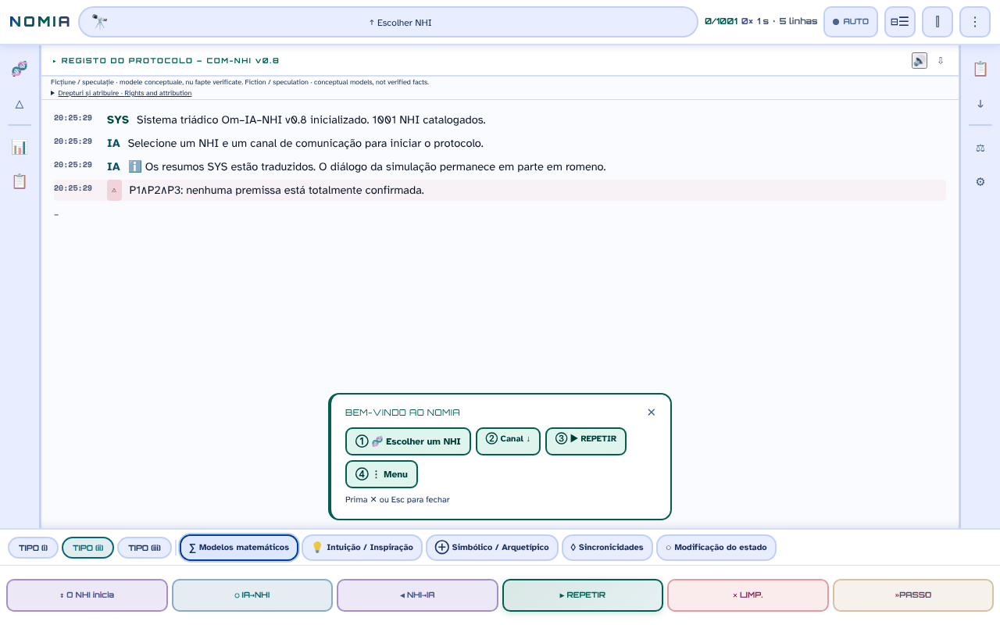

# NOMIA — Om·IA·NHI

[English](README.md) · [Română](README.ro.md) · [Français](README.fr.md) · [Italiano](README.it.md) · [Español](README.es.md) · **Português** · [Deutsch](README.de.md) · [Magyar](README.hu.md)

**Versão:** 1.0.1 · **Última atualização:** 2026-10-27

**Estado:** estável; ficção/especulação, companheira da antologia · **Offline:** completo após o primeiro carregamento (pacotes de idioma e dados de protocolo carregados a pedido da mesma origem e guardados em cache pelo service worker; sem pedidos externos)

Idiomas da interface: **Română, English, Français, Italiano, Español, Português (PT), Deutsch, Magyar**

**Online / demo:** https://chiuta.github.io/NOMIA/

**Ficção / especulação.** Aplicação concetual, companheira da antologia *Printre inteligențe* (2026). Os protocolos, as pontuações e as «sessões» são modelos narrativos e concetuais, não factos verificados.

## O que é

O NOMIA é uma aplicação de um único ficheiro (`index.html`, PWA) que simula «protocolos de contacto» trilógicos Humano–IA–NHI (inteligências não humanas) em 5 canais (matemático, intuição, simbólico, sincronicidades, alteração do estado), com interface em 8 idiomas (RO, EN, FR, IT, ES, PT, DE, HU; as fichas do catálogo e os textos UAP estão integralmente traduzidos; as narrativas dos protocolos só estão traduzidas em parte (ver «Limitações»)). O catálogo contém 1001 entradas em 14 categorias: animais (primatas, cetáceos, mamíferos, aves, cefalópodes, insetos, fauna da Roménia), entidades coletivas e não neuronais, «Tradições esotéricas», «Tradições religiosas» e «Hipóteses modernas» (incluindo hipóteses sobre UAP/NHI). As entradas sobre animais baseiam-se em literatura científica citada nas fichas; as entradas esotéricas e religiosas e as hipóteses sobre UAP/NHI são apresentadas como ideias, não como provas, e as fichas assinalam-nas muitas vezes como especulativas ou não confirmadas. O painel «Eixo B» avisa explicitamente: «elevada incerteza epistémica».

## Como se utiliza

1. Abra `index.html` (ou instale-o como aplicação a partir do navegador).
2. Escolha um NHI em «Escolher NHI» (ou no menu 🧬 / categorias) e um canal.
3. Carregue em ▶ REIA (retomar) para executar o protocolo linha a linha; ■ STOP, ⏸ e »STEP controlam a execução.
4. Os menus da barra lateral oferecem comparações, estatísticas, um registo, exportações (TXT, Markdown, instantâneos) e definições (tema, idioma, tamanho do tipo de letra).

## Que dados saem do navegador

Nenhuns. No código não existem `fetch`/XHR/WebSocket nem scripts, tipos de letra ou imagens externos (CSP `default-src 'self'`, scripts permitidos apenas por hash, sem `'unsafe-inline'` para scripts). Os únicos endereços externos são as ligações de apoio (Buy Me a Coffee). As preferências, o histórico de sessões, as notas e os favoritos ficam guardados apenas em `localStorage` (chaves `nomia_*`). O service worker (`sw.js`) coloca em cache apenas ficheiros da mesma origem para funcionamento offline.

## Limitações

- **Idiomas:** as fichas do catálogo (locais, legendas, incógnitas, referências: 100%) e os 301 textos UAP estão traduzidos para fr, it, es, pt, de, hu, tal como a nota «Direitos e atribuição» (RO+EN mantêm-se como versão de referência). As narrativas dos protocolos (cerca de 2,5 milhões de carateres apresentados) estão agora traduzidas quase por completo: cerca de 11 500 frases únicas traduzidas diretamente cobrem cerca de 91% dos carateres das narrativas (cerca de 99,6% contando os fragmentos iniciais); apenas um pequeno resíduo (cerca de 0,4% contando os fragmentos iniciais: frases ainda não traduzidas) **permanece em romeno** nos outros idiomas. As traduções são automáticas, não verificadas por falantes nativos; o conteúdo religioso, médico (p. ex. enxaqueca de Sacks, Hildegarda, hipótese de Jaynes, resistência ao cancro) e especulativo/folclórico/UAP, bem como a nota jurídica, **precisam de revisão especializada**.
- Conteúdo informativo e criativo; não constitui aconselhamento científico, médico ou jurídico. O conteúdo esotérico/religioso não tem validação científica.
- Textos gerados a partir de modelos: os resultados do «protocolo» não são medições.

## Ficheiros

- `index.html` — a aplicação; `manifest.webmanifest`, `sw.js`, `icon-*.png` — PWA.
- `tests/` — testes Playwright (veja `tests/README.md`).

## Licença

MIT — veja o ficheiro LICENSE. Declarada no cabeçalho de `index.html`.

**NOTICE – conteúdo com coautor.** A licença MIT aplica-se ao código da aplicação e aos textos escritos por Alexandru-Ionuț Chiuță. Os fragmentos provenientes do Anexo I, cap. 14 da antologia *Printre inteligențe* (2026, assinada Urzică & Chiuță) são obra de dois coautores; o coautor não confirmou (nos materiais auditados) o licenciamento MIT para a sua parte, e este repositório não o pressupõe. Os títulos e nomes de algumas obras de terceiros (p. ex. *Solaris*, *Norul Negru*, *Monolitul*, *Prima Directivă*) pertencem aos respetivos titulares e são usados a título descritivo.

## Direitos e atribuição

- **Parte do autor:** a licença declarada (MIT) aplica-se APENAS ao código da aplicação e aos textos escritos por Alexandru-Ionuț Chiuță.
- **Coautor:** Anexo I, cap. 14 de *Printre inteligențe* (Urzică & Chiuță) – o coautor não confirmou o licenciamento MIT; não é pressuposto.
- **Materiais de terceiros:** títulos/nomes de obras (usados a título descritivo) e as referências científicas das fichas pertencem aos respetivos titulares; a licença MIT não os abrange.
- **Retificação / retirada:** se é titular de direitos ou uma pessoa mencionada e deseja a correção ou a retirada, escreva para alexio@trom.tf; respondemos em 7 dias.

*EN:* The MIT licence applies ONLY to the code and to texts written by Alexandru-Ionuț Chiuță. The co-authored part (Annex I, Ch. 14, Urzică & Chiuță) is not assumed to be MIT-licensed; third-party materials belong to their holders and are not covered by the MIT licence. Rights holders or persons mentioned may request correction or withdrawal at alexio@trom.tf (reply within 7 days). The same note is visible in the app (log bar, "Drepturi și atribuire").

## Auditoria

Auditoria: 2026-10-10 (ronda 3: nota de direitos e atribuição). Correções de acessibilidade (funções ARIA, contraste nos temas claro e escuro, etiquetas) e adição da nota «Ficção / especulação» na aplicação.

## Autor

Alexio — Alexandru-Ionuț Chiuță, contacto: alexio@trom.tf.

## Novidades (v0.9.0)

- **Leitura do registo de protocolo em voz alta** (botão 🔊 no cabeçalho do registo, FFF.tts): lê as linhas das mensagens por ordem (sem as etiquetas OM/IA/NHI), com a voz local do navegador, no idioma ativo (ro/en); «⏹» para a leitura. O texto não sai do dispositivo; se não houver voz, surge uma mensagem. Não lê o registo à medida que aparece, mas o que está apresentado no momento em que carrega no botão.
- **Etiqueta de transparência e cópia .fff.json** (kit comum: core, label, bundle, tts): clique em `v 0.9.0 · 2026-10-14` em «Estatísticas · Definições»; mostra o armazenamento local e a rede (0 pedidos), exporta/importa (opcionalmente cifrados com palavra-passe) o histórico, os itens fixados e as definições. As exportações existentes (TXT, Markdown, instantâneo) mantêm-se.
- Cache do Service Worker: nomia-v6. CSP inalterada (apenas os hashes dos scripts, recalculados).
- Os textos novos estão em ro, en, fr, it, es, pt, hu, de; as traduções fr/it/es/pt/hu/de são automáticas e não verificadas por nativos.
- Testes: `tests/fff-r8.test.mjs` (Node + Playwright; rede bloqueada, 1280 e 360 px, axe 0 violações); os testes Python existentes correm como antes.

## Histórico / Changelog
- **0.10.17 — 2026-10-23:** Acessibilidade: em ecrãs táteis os botões 🔊 (leitura) e deslocamento automático ficavam com 24 px por uma regra CSS posterior; agora têm 44 px.
- **0.10.16 — 2026-10-23:** Armazenamento: as chaves passam a ter o prefixo da aplicação (`nomia.a11y`); os dados existentes são migrados automaticamente no arranque a partir das chaves antigas (`a11y`) e as cópias `.fff.json` antigas continuam a ser importadas (fff-kit 1.2.0).
- **0.10.14 — 2026-10-22:** Peso: a página desce de 18,6 MB para 3,3 MB. O dicionário em 8 idiomas é dividido em pacotes de idioma (`i18n/keys.js` + um ficheiro por idioma, carregado só para o idioma escolhido) e as variantes de protocolo NHI→Humano / IA→NHI / NHI→IA (2,4 MB) estão em `data/variants.js`, carregado na primeira utilização; o service worker serve-os primeiro da cache e, quando a página está inativa, descarrega os outros pacotes em segundo plano (não com Save-Data / ligações lentas), pelo que a aplicação continua totalmente offline. Se um pacote não puder ser carregado (offline antes de o descarregar), mostra-se o texto original com um aviso no idioma escolhido. Sem tremeluzir de texto por traduzir (a página aparece quando chega o pacote, no máximo após 6 s). Novo teste: `tests/lazy.test.mjs`.
- **0.10.13 — 2026-10-22:** fff-kit 1.1.4: áreas de toque e tamanho mínimo do texto na interface comum; áreas de toque/texto corrigidos (botões de leitura e rolagem automática, guardar pesquisa, faixa de primeira utilização, nota de direitos, rótulos dos canais, rótulos do modelo triádico).
- **0.10.12 — 2026-10-22:** Segurança: a mensagem «Nenhum NHI para …» e os botões das pesquisas guardadas deixaram de inserir a consulta escrita como HTML (DOM-XSS latente).
- **0.10.11 — 2026-10-22:** fff-kit 1.1.2: PBKDF2 600 000 iterações, proteção anti-clickjacking.
- **0.10.10 (22 de outubro de 2026):** Acessibilidade e telemóvel: um único H1, nomes acessíveis nos 1001 botões NHI (derivados do nome da entrada) e nos campos de pesquisa, texto de pelo menos 12 px em cartões e filtros; confirm() substituído por diálogos integrados traduzidos; as exportações CSV neutralizam os prefixos de fórmula (=, +, -, @).
- **0.10.9 — 2026-10-22:** os 1001 nomes de entidades (p. ex. «Girafas», «A hipótese do zoo», «Avestruzes-comuns») estão agora traduzidos em fr/it/es/pt/de/hu na lista, na pesquisa e nas fichas; a tabela e o painel de detalhes dos UAP, as descrições dos canais e o registo de arranque já não mostram romeno (nem inglês em romeno).
- **0.10.8 — 2026-10-22:** o título, a nota de direitos e os nomes das categorias (tradições esotéricas/religiosas, hipóteses modernas, cefalópodes) seguem agora o idioma da interface.
- **0.10.7 — 2026-10-22:** a validação das traduções aceita agora o formato numérico local (10.000 / 10,000 / 10 000, 1.2 / 1,2) e os números expressos por extenso ou em ordinais; cerca de 320 frases anteriormente rejeitadas foram revistas e integradas (todas traduções corretas: números por extenso, formato de hora, séculos em algarismos romanos, escala dos «triliões»): cerca de 11 500 frases únicas, cerca de 91% dos carateres das narrativas (cerca de 99,6% contando os fragmentos iniciais); nenhuma frase é já rejeitada na validação.
- **0.10.6 — 2026-10-21:** as narrativas dos protocolos estão agora traduzidas para fr, it, es, pt, de, hu quase por completo: cerca de 11 400 frases únicas traduzidas diretamente, cerca de 91% dos carateres das narrativas (cerca de 99% contando os fragmentos iniciais); apenas um pequeno resíduo permanece em romeno. As traduções são automáticas, não verificadas por falantes nativos, e precisam de revisão especializada (conteúdo religioso, médico, especulativo/folclórico/UAP e nota jurídica).
- **0.10.5 — 2026-10-19:** a nota «Direitos e atribuição» está traduzida para fr, it, es, pt, de, hu (RO+EN mantêm-se como versão de referência); divisor de frases e mais 105 modelos com espaços, além de 277 frases traduzidas: cerca de 59% dos carateres das narrativas dos protocolos estão agora traduzidos (68% contando os fragmentos iniciais). As traduções precisam de revisão especializada (jurídica).
- **0.10.4 — 2026-10-19:** as fichas do catálogo e os textos UAP estão traduzidos para fr, it, es, pt, de, hu; recurso ao nível da frase para os 331 modelos narrativos mais frequentes (cerca de metade dos carateres das narrativas). **0.10.1:** os avisos de anular / primeira utilização e o toast recuperam a margem inferior e a largura (`calc()` inválido).
- **0.9.1 — 18 de outubro de 2026:** a ligação `?nhi=<id>` aceita ids com diacríticos (`murmurații`, `leopard-nebuloși`; regex Unicode `\p{L}`), e «Copiar ligação» codifica o id (`encodeURIComponent`); cache SW nomia-v6; testes para `?nhi=`.
- **0.9.0 — 14 de outubro de 2026:** leitura do registo em voz alta (FFF.tts); etiqueta de transparência e cópia .fff.json (kit comum); cache SW nomia-v5; testes `tests/fff-r8.test.mjs`.

- **0.8.58 — 2026-10-12:** a versão e a data da última atualização são mostradas na aplicação (painel «Estatísticas · Definições»)
- **0.8.57 — 11 de outubro de 2026:** Escape fecha agora o aviso «Bem-vindo» (o texto anunciava-o, mas a tecla não fazia nada), e o aviso fecha-se sozinho quando escolhe um NHI (já não cobre o registo); os canais incompatíveis com o perfil de um NHI têm a explicação no `title` da barra inferior, e escolhê-los escreve no registo o motivo e a lista de canais compatíveis (antes: apenas um contorno ponteado); CSP recalculada; 0 erros, axe 0 violações a 1280×800 e 360×740. As caixas de diálogo-modelo e `style-src 'unsafe-inline'` mantêm-se inalterados (decisão de conteúdo / numerosos atributos style).
- **0.8.56 — 11 de outubro de 2026:** os 168 manipuladores em linha (`onclick`, `onkeydown`, `oninput`, `onmouseover/out`) são substituídos por um único despachante delegado (`data-onclick` etc. + argumentos literais em `data-arg`; sem `eval`/`Function`); paridade verificada com Playwright (mesmas chamadas de função, mesmos argumentos e mesmo estado da página para 156 189 eventos simulados, em 17 estados da interface); CSP com `script-src 'self'` + hashes SHA-256, sem `'unsafe-inline'` para scripts (e sem `blob:` para scripts); os textos de protocolo com o habitat cortado entre parênteses («África Central (Congo.») são completados com o valor inteiro dos dados (14 cadeias, 7 NHI); a notificação «Copiado/Copied» ao copiar uma linha do registo segue agora o idioma da aplicação. Os estilos em linha (`style-src 'unsafe-inline'`) mantêm-se.
- **0.8.55 — 11 de outubro de 2026:** enquanto uma folha (NHI Browser, menu, estatísticas) está aberta, um clique em REIA / STOP / ⏸ / »STEP visíveis através do fundo fecha a folha e aciona o botão (antes o fundo «engolia» o clique; CLR continua sem ser acionado, por ser destrutivo); os textos do registo já não são cortados a meio das palavras (p. ex. «name-lik.») — o corte faz-se agora no limite da palavra (29 locais nos modelos de diálogo + a nota de evidência); a cache do service worker passa a `nomia-v4`.
- Acessibilidade: as barras laterais são `nav` (a função `navigation` não era permitida em `aside`), o aviso de boas-vindas e o widget de apoio têm pontos de referência; axe-core: 0 violações a 1280×800 e 360×740. Os 166 manipuladores em linha foram removidos em 0.8.56 (veja acima). Os testes de `tests/` (Python) não foram executados aqui (o ambiente só tem Node/Playwright); a verificação fez-se com Playwright/Node: sem erros JS, sintaxe dos scripts válida, fluxo «folha aberta → REIA» funcional.
