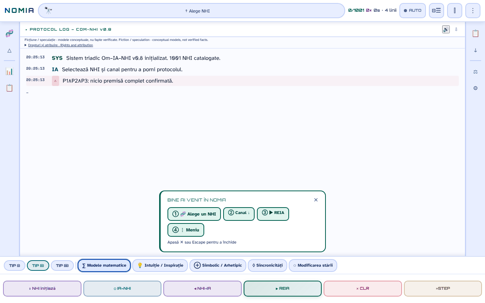

# NOMIA — Om·IA·NHI

[English](README.md) · **Română** · [Français](README.fr.md) · [Italiano](README.it.md) · [Español](README.es.md) · [Português](README.pt.md) · [Deutsch](README.de.md) · [Magyar](README.hu.md)

**Versiune:** 0.10.3 · **Ultima actualizare:** 2026-10-19

Limbile interfeței: **Română, English, Français, Italiano, Español, Português (PT), Deutsch, Magyar**

**Live / demo:** https://chiuta.github.io/NOMIA/

**Ficțiune / speculație (Fiction / speculation).** Aplicație conceptuală, companion al antologiei *Printre inteligențe* (2026). Protocoalele, scorurile și „sesiunile” sunt modele narative și conceptuale, nu fapte verificate.

## Ce este

NOMIA este o aplicație single-file (`index.html`, PWA) care simulează „protocoale de contact” trilogice Om–IA–NHI (inteligențe non-umane) pe 5 canale (matematic, intuiție, simbolic, sincronicități, modificarea stării), cu interfață în 8 limbi (RO, EN, FR, IT, ES, PT, DE, HU; catalogul și textele lungi sunt în română și engleză). Catalogul conține 1001 de intrări, în 14 categorii: animale (primate, cetacee, mamifere, păsări, cefalopode, insecte, faună din România), entități colective și non-neuronale, „Tradiții esoterice”, „Tradiții religioase” și „Ipoteze moderne” (inclusiv ipoteze despre UAP/NHI). Intrările despre animale se bazează pe literatură științifică citată în fișe; intrările esoterice, religioase și ipotezele despre UAP/NHI sunt prezentate ca idei, nu ca dovezi, iar fișele le marchează adesea ca speculative sau neconfirmate. Panoul „Axa B” avertizează explicit: „incertitudine epistemică ridicată”.

## Cum se folosește

1. Deschide `index.html` (sau instalează-l ca aplicație din browser).
2. Alege un NHI din „Alege NHI” (sau din meniul 🧬 / categorii) și un canal.
3. Apasă ▶ REIA pentru a rula protocolul linie cu linie; ■ STOP, ⏸ și »STEP controlează rularea.
4. Meniurile din bara laterală oferă comparații, statistici, jurnal, exporturi (TXT, Markdown, snapshot-uri) și setări (temă, limbă, mărime font).

## Ce date pleacă din browser

Niciuna. În cod nu există `fetch`/XHR/WebSocket și nici scripturi, fonturi sau imagini externe (CSP `default-src 'self'`, scripturile permise doar pe hash, fără `'unsafe-inline'` pentru script). Singurele adrese externe sunt linkurile de sprijin (Buy Me a Coffee). Preferințele, istoricul sesiunilor, notele și favoritele se păstrează doar în `localStorage` (chei `nomia_*`). Service worker-ul (`sw.js`) ține în cache doar fișierele aceleiași origini pentru funcționare offline.

## Limitări

- Conținut informativ și creativ; nu este sfat științific, medical sau juridic. Conținutul esoteric/religios nu are validare științifică.
- Texte generate din șabloane: rezultatele „protocolului” nu sunt măsurători.

## Fișiere

- `index.html` — aplicația; `manifest.webmanifest`, `sw.js`, `icon-*.png` — PWA.
- `tests/` — teste Playwright (a se vedea `tests/README.md`).

## Licență

MIT — vezi fișierul LICENSE. Declarată în antetul `index.html`.

**NOTICE – conținut cu coautor.** Licența MIT se aplică codului aplicației și textelor scrise de Alexandru-Ionuț Chiuță. Fragmentele care provin din Anexa I, Cap. 14 a antologiei *Printre inteligențe* (2026, semnat Urzică & Chiuță) sunt opera a doi coautori; coautorul nu a confirmat (în materialele auditate) licențierea MIT pentru partea sa, iar acest repository nu o presupune. Titlurile și numele unor opere terțe (de ex. *Solaris*, *Norul Negru*, *Monolitul*, *Prima Directivă*) aparțin deținătorilor lor și sunt folosite descriptiv.

## Drepturi și atribuire / Rights and attribution

- **Partea autorului:** licența declarată (MIT) se aplică DOAR codului aplicației și textelor scrise de Alexandru-Ionuț Chiuță.
- **Coautor:** Anexa I, Cap. 14 din *Printre inteligențe* (Urzică & Chiuță) – coautorul nu a confirmat licențierea MIT; nu este presupusă.
- **Materiale terțe:** titluri/nume de opere (folosite descriptiv) și referințele științifice din fișe aparțin titularilor; licența MIT nu le acoperă.
- **Rectificare / retragere:** dacă ești titular de drepturi sau persoană menționată și dorești corectarea sau retragerea, scrie la alexio@trom.tf; răspundem în 7 zile.

*EN:* The MIT licence applies ONLY to the code and to texts written by Alexandru-Ionuț Chiuță. The co-authored part (Annex I, Ch. 14, Urzică & Chiuță) is not assumed to be MIT-licensed; third-party materials belong to their holders and are not covered by the MIT licence. Rights holders or persons mentioned may request correction or withdrawal at alexio@trom.tf (reply within 7 days). The same note is visible in the app (log bar, "Drepturi și atribuire").

## Audit

Audit: 2026-10-10 (rundă 3: notă de drepturi și atribuire). Corecturi de accesibilitate (roluri ARIA, contrast în temele luminoasă și întunecată, etichete) și adăugarea notei „Ficțiune / speculație” în aplicație.

## Autor

Alexio — Alexandru-Ionuț Chiuță, contact: alexio@trom.tf.

## Funcții noi (v0.9.0)

- **Citirea jurnalului de protocol cu voce** (butonul 🔊 din antetul jurnalului, FFF.tts): citește liniile mesajelor în ordine (fără etichetele OM/IA/NHI), cu vocea locală a browserului, în limba activă (ro/en); „⏹” oprește. Textul nu pleacă din dispozitiv; dacă nu există voce, apare un mesaj. Nu citește jurnalul pe măsură ce apare, ci ce este afișat în momentul apăsării.
- **Etichetă de transparență și copie .fff.json** (kit comun: core, label, bundle, tts): clic pe `v 0.9.0 · 2026-10-14` din „Statistici · Setări”; arată stocarea locală și rețeaua (0 cereri), exportă/importă (opțional criptat cu parolă) istoricul, fixările și setările. Exporturile existente (TXT, Markdown, snapshot) rămân.
- Cache Service Worker: nomia-v6. CSP neschimbat (doar hash-urile scripturilor, recalculate).
- Textele noi sunt în ro, en, fr, it, es, pt, hu, de; traducerile fr/it/es/pt/hu/de sunt automate și neverificate nativ.
- Teste: `tests/fff-r8.test.mjs` (Node + Playwright; rețea blocată, 1280 și 360 px, axe 0 violări); testele Python existente rulează ca înainte.

## Istoric / Changelog

- **0.9.1 — 18 octombrie 2026:** linkul `?nhi=<id>` acceptă id-uri cu diacritice (`murmurații`, `leopard-nebuloși`; regex Unicode `\p{L}`), iar „Copiază link” codifică id-ul (`encodeURIComponent`); cache SW nomia-v6; teste pentru `?nhi=`.
- **0.9.0 — 14 octombrie 2026:** citirea jurnalului cu voce (FFF.tts); etichetă de transparență și copie .fff.json (kit comun); cache SW nomia-v5; teste `tests/fff-r8.test.mjs`.

- **0.8.58 — 2026-10-12:** versiunea și data ultimei actualizări sunt afișate în aplicație (panoul „Statistici · Setări”)
- **0.8.57 — 11 octombrie 2026:** Escape închide acum banner-ul „Bine ai venit” (textul îl anunța, dar tasta nu făcea nimic), iar banner-ul se închide singur când alegi un NHI (nu mai acoperă jurnalul); canalele incompatibile cu profilul unui NHI au în bara de jos explicația în `title`, iar alegerea lor scrie în jurnal motivul și lista canalelor compatibile (înainte: doar chenar punctat); CSP recalculat; 0 erori, axe 0 violări la 1280×800 și 360×740. Dialogurile-șablon și `style-src 'unsafe-inline'` rămân neschimbate (decizie de conținut / atribute style numeroase).
- **0.8.56 — 11 octombrie 2026:** cele 168 de handlere inline (`onclick`, `onkeydown`, `oninput`, `onmouseover/out`) sunt înlocuite cu un singur dispecer delegat (`data-onclick` etc. + argumente literale în `data-arg`; fără `eval`/`Function`); paritate verificată prin Playwright (aceleași apeluri de funcții, aceleași argumente și aceeași stare a paginii pentru 156.189 de evenimente simulate, pe 17 stări ale interfeței); CSP cu `script-src 'self'` + hash-uri SHA-256, fără `'unsafe-inline'` pentru script (și fără `blob:` la scripturi); textele de protocol cu habitatul tăiat în paranteză („Africa Centrală (Congo.”) sunt completate cu valoarea întreagă din date (14 șiruri, 7 NHI); toast-ul „Copiat/Copied” la copierea unei linii din log urmează acum limba aplicației. Stilurile inline (`style-src 'unsafe-inline'`) rămân.
- **0.8.55 — 11 octombrie 2026:** cât timp o foaie (NHI Browser, meniu, statistici) este deschisă, un clic pe REIA / STOP / ⏸ / »STEP vizibile prin backdrop închide foaia și acționează butonul (înainte backdrop-ul „înghițea” clicul; CLR rămâne neacționat, fiind distructiv); textele din log nu se mai taie în mijlocul cuvintelor (de ex. „name-lik.”) — tăierea se face acum la limită de cuvânt (29 de locuri în șabloanele de dialog + nota de evidență); cache-ul service worker devine `nomia-v4`.
- Accesibilitate: barele laterale sunt `nav` (rolul `navigation` nu era permis pe `aside`), banner-ul de bun venit și widgetul de sprijin au repere; axe-core: 0 violări la 1280×800 și 360×740. Cele 166 de handlere inline au fost eliminate în 0.8.56 (vezi mai sus). Testele din `tests/` (Python) nu au fost rulate aici (mediul are doar Node/Playwright); verificarea s-a făcut cu Playwright/Node: fără erori JS, sintaxa scripturilor validă, fluxul „foaie deschisă → REIA” funcțional.
